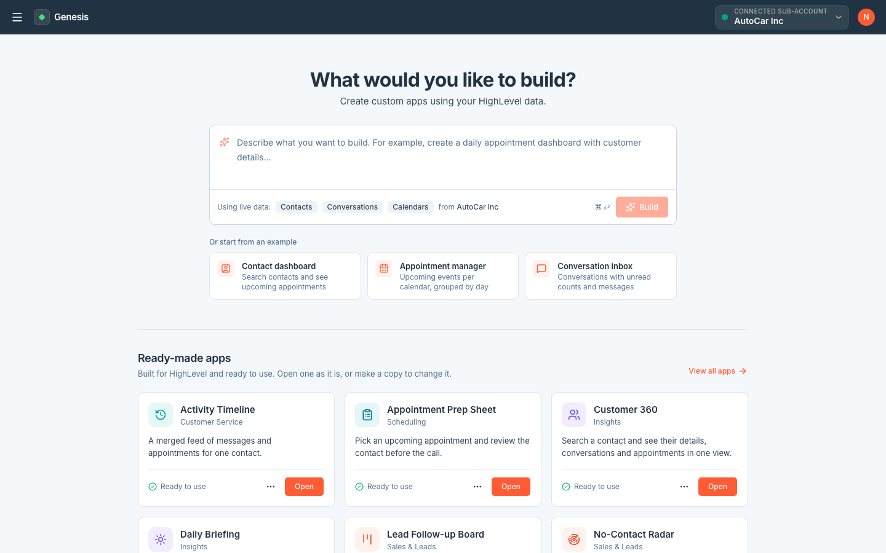
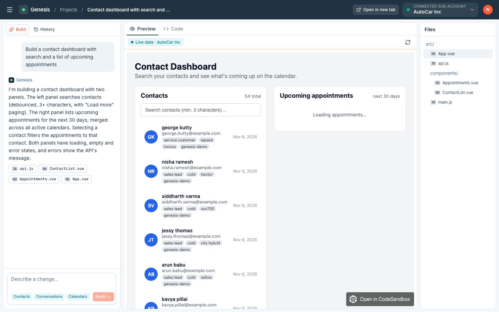
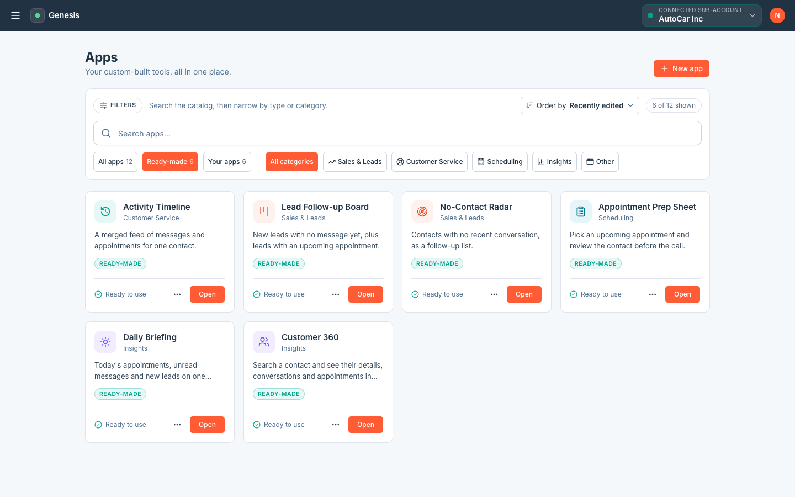
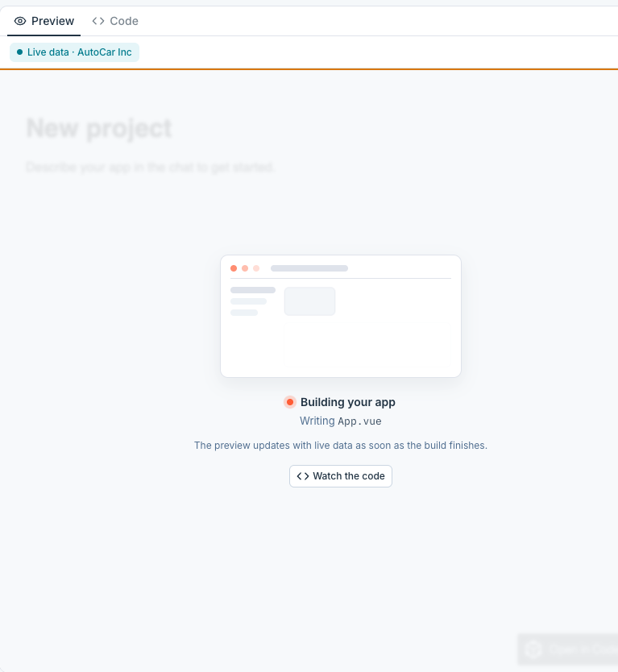
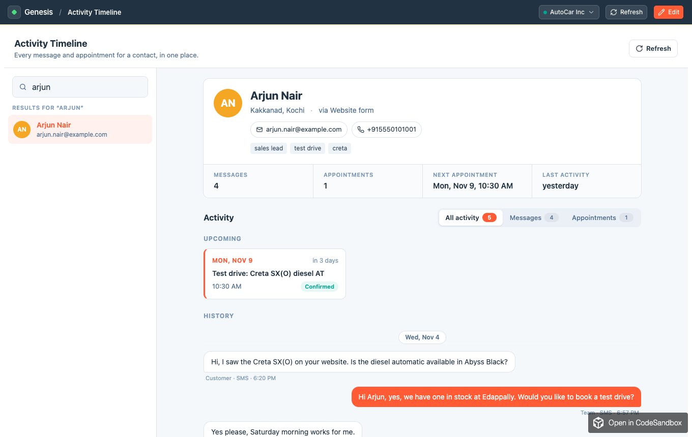
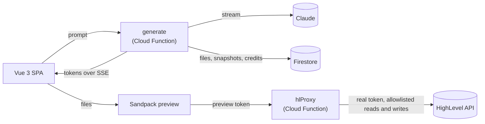

# Genesis — AI-powered HighLevel app builder

[](https://github.com/nirmalbenny/genesis/actions/workflows/deploy.yml)

Describe an app in plain English. Genesis streams the code from Claude into a live editor and runs the result on your **real HighLevel data**: contacts, conversations and calendars.

**[Live app](https://genesisaibuilder.web.app)** · **[Architecture diagram](docs/ARCHITECTURE.md#2-system-overview)** · **[Architecture & flows](docs/ARCHITECTURE.md)** · **[Local setup](#local-setup-firebase-emulators)**



| Build with a prompt, preview on live data | Ready-made apps, catalog and launch |
|---|---|
|  |  |
|  |  |

## Contents

[Features](#features) · [How it works](#how-it-works) · [Live URLs](#live-urls) · [Tech stack](#tech-stack) · [Repository layout](#repository-layout) · [Local setup](#local-setup-firebase-emulators) · [Configuration](#configuration-reference) · [Scripts & tests](#scripts--tests) · [HighLevel setup](#highlevel-setup) · [Architecture decisions](#architecture-decisions) · [AI at a glance](#ai-at-a-glance) · [Security at a glance](#security-at-a-glance) · [Rate limits](#rate-limits) · [What I would improve](#what-i-would-improve) · [Deployment notes](#deployment-notes) · [Troubleshooting](#troubleshooting) · [License](#license)

## Features

- **HighLevel connection:** sign in, then connect a sub-account with OAuth 2.0. Tokens stay on the server, encrypted, and refresh automatically.
- **Apps that read and write:** generated apps show live contacts, conversations and calendars, and can create and update contacts (with tags and notes), book, reschedule and cancel appointments, mark conversations read or starred, and send SMS or email. Deletes are never allowed.
- **Prompt-first workspace:** describe an app and name it, then watch Claude's output stream into Monaco (read-only while it streams). The preview shows a "Building your app" overlay meanwhile.
- **Live preview:** apps run in a Sandpack iframe and call HighLevel through a secure proxy. They never see your token.
- **Generated apps paginate:** contacts, conversations and messages load 20 at a time behind Load more. Calendar apps can show events and open booking slots.
- **Stop a build:** press Stop or Esc mid-stream. Finished files are kept, the half-written one is discarded, and only the tokens used are charged.
- **Edit and refine:** edit code by hand or refine with follow-up prompts. Every build is a **snapshot** with an AI-written summary, and any of them can be restored from the History sheet.
- **Ready-made apps:** six for every user (Customer 360, Daily Briefing, Appointment Prep Sheet, No-Contact Radar, Lead Follow-up Board and Activity Timeline). They're locked, but can be launched, copied and pinned to the sidebar.
- **App catalog:** search, type and category filters, ordering, pinning, and full-screen launch at `/run/:id`.
- **AI credits:** every user gets **2,500 credits** once they verify their email (1 credit = $0.001 of Claude list price). Each build holds its worst-case cost up front, then is charged what it actually used. The balance is shown live in the top bar, and every grant, hold and charge is recorded in a ledger.
- **Rate limiting:** builds are limited exactly (1 at a time per app, 2 per user, 10 starts per 10 minutes) before any credits are held or Claude is called. The proxy and API are throttled per user; the proxy also caches repeated reads and backs off when HighLevel returns 429. See [Rate limits](#rate-limits).
- **Account safety:** email verification is required before anything works, reCAPTCHA Enterprise screens every sign-up and sign-in, and stored HighLevel tokens are encrypted with Cloud KMS.
- **Graceful failure:** handles malformed model output, interrupted streams, failed HighLevel calls, declined off-topic or harmful prompts, and a missing connection, each with a clear message.

## How it works



1. **Build:** the browser sends a prompt to `generate`, which holds the worst-case credits, streams Claude's output back over SSE, and saves the validated files with a snapshot.
2. **Run:** the preview runs the files in Sandpack. The generated app reads and writes HighLevel only through `hlProxy`, with a short-lived preview token; the real HighLevel token never leaves the server.
3. **Store:** clients read their own data straight from Firestore, but every write goes through Cloud Functions.

This is the short version. The **[detailed architecture diagram](docs/ARCHITECTURE.md#2-system-overview)** shows every component (Auth, all five functions, the shared modules, Firestore, Secret Manager, Cloud KMS, CI/CD) with the five main flows numbered. The rest of [`docs/ARCHITECTURE.md`](docs/ARCHITECTURE.md) covers the data model, API, flows and the reasoning behind each decision.

## Live URLs

- **App (Firebase Hosting):** <https://genesisaibuilder.web.app>
- **Cloud Functions base:** `https://us-central1-genesisaibuilder.cloudfunctions.net` (functions: `api`, `generate`, `hlProxy`, `hlAuthStart`, `hlAuthCallback`)
- **Loom walkthrough:** _TBD_

## Tech stack

| Layer | Choice |
|---|---|
| Backend | Firebase Auth (email/password), Firestore, Cloud Functions 2nd gen on **Node 24**, TypeScript |
| AI | Claude via `@anthropic-ai/sdk`: streaming generation, plus Haiku for snapshot summaries |
| Frontend | Vue 3 + TypeScript + Vite, **shadcn-vue** (Tailwind v4), `@lucide/vue`, `vue-router` |
| Editor / preview | `@guolao/vue-monaco-editor`, `@codesandbox/sandpack-client` |
| HighLevel | OAuth 2.0 (Location), Contacts, Conversations and Calendars APIs (reads plus allowlisted writes, no deletes) |
| Hosting | Firebase Hosting (SPA) and Firebase Functions (us-central1) |
| Security | Identity Platform + reCAPTCHA Enterprise, Cloud KMS (token encryption), Secret Manager |
| Quality | `node:test` (unit + integration on the emulators), Vitest, ESLint, GitHub Actions CI/CD |

## Repository layout

```text
.
├── functions/                 Cloud Functions (TypeScript), see functions/README.md
│   ├── src/                   api · generate (SSE) · hlProxy · hl/ (OAuth, token refresh) · llm/ (prompt, parser, validator)
│   │   ├── *.test.ts          unit tests (npm test)
│   │   └── e2e/               integration tests against the emulators (npm run test:e2e)
│   └── templates/             six ready-made apps (templates.json + <slug>/src/**)
├── frontend/                  Vue 3 SPA, see frontend/README.md
│   ├── src/                   views · components (ui/ = shadcn-vue) · composables · lib, with *.test.ts beside the code
│   └── scripts/dev.mjs        npm run dev: Cloudflare tunnel + Vite
├── .github/workflows/         deploy.yml: lint and tests on every push and PR, deploy to Firebase on main
├── scripts/                   one-time setup: setup-github-deploy.sh (CI), setup-bot-protection.sh (reCAPTCHA),
│                              setup-token-encryption.sh (Cloud KMS)
├── docs/
│   ├── ARCHITECTURE.md        goals, system design, data model, API, flows, credits, rate limits, security, testing
│   └── screenshots/
├── firebase.json · .firebaserc · firestore.rules · firestore.indexes.json
└── .env.example               every environment variable, grouped by the file it belongs in
```

## Local setup (Firebase emulators)

**Prerequisites:**

- **Node 24**, the Cloud Functions runtime
- **Java 21+** for the Firestore emulator (required by `firebase-tools` 15)
- **Firebase CLI:** `npm i -g firebase-tools`
- **[`cloudflared`](https://developers.cloudflare.com/cloudflare-one/connections/connect-networks/downloads/)**, for example `brew install cloudflared`
- **Accounts:** a HighLevel Marketplace app ([setup below](#highlevel-setup)) and an Anthropic API key

1. **Install**

   ```bash
   git clone https://github.com/nirmalbenny/genesis.git && cd genesis
   (cd functions && npm install) && (cd frontend && npm install)
   firebase use <project-id>          # or edit .firebaserc
   ```

2. **Configure.** Each variable is described in [`.env.example`](.env.example).

   ```bash
   cp functions/.env.example functions/.env          # ANTHROPIC_MODEL, ANTHROPIC_SUMMARY_MODEL
   # functions/.env.local      HL_REDIRECT_URI=http://127.0.0.1:5001/<project-id>/us-central1/hlAuthCallback
   #                           APP_URL=http://localhost:5173
   #                           LOCAL_TOKEN_KEK=<openssl rand -base64 32>
   # functions/.secret.local   ANTHROPIC_API_KEY=…  HL_CLIENT_ID=…  HL_CLIENT_SECRET=…  PREVIEW_TOKEN_SECRET=<openssl rand -hex 32>
   cp frontend/.env.example frontend/.env.local      # Firebase web config; VITE_USE_EMULATORS=true
   ```

3. **Run** in two terminals:

   ```bash
   firebase emulators:start           # auth :9099 · firestore :8080 · functions :5001 · UI :4000
   cd frontend && npm run dev         # tunnel to :5001, then Vite on http://localhost:5173
   ```

4. **Use it:** open <http://localhost:5173> and sign up. Click the verification link from the Auth emulator (Emulator UI, port 4000, or the emulator log), then choose **Connect HighLevel** (pick your sandbox sub-account), then describe an app.

**Why `npm run dev` opens a tunnel:** Chrome's Local Network Access protection blocks the Sandpack preview, which runs on a public origin, from calling `127.0.0.1`. [`frontend/scripts/dev.mjs`](frontend/scripts/dev.mjs) handles it:

- it opens a Cloudflare quick tunnel to the functions emulator;
- it waits until the tunnel is reachable and prints the URL;
- it starts Vite with `VITE_FUNCTIONS_BASE_URL` set to the tunnel.

Ctrl+C stops both. `npm run dev:local` runs plain Vite without a tunnel. Deployed builds don't need any of this.

## Configuration reference

| Variable | File | Purpose |
|---|---|---|
| `ANTHROPIC_MODEL` | `functions/.env` | Claude model for generation |
| `ANTHROPIC_SUMMARY_MODEL` | `functions/.env` | Small model for one-line snapshot summaries (default `claude-haiku-5-5`) |
| `HL_REDIRECT_URI` | `functions/.env.local` · `.env.<project-id>` | OAuth callback URL, which must be registered in the HighLevel app |
| `APP_URL` | `functions/.env.local` · `.env.<project-id>` | Where the OAuth callback sends the browser back |
| `ANTHROPIC_API_KEY` | secret | Claude API key |
| `HL_CLIENT_ID`, `HL_CLIENT_SECRET` | secret | HighLevel Marketplace app credentials |
| `PREVIEW_TOKEN_SECRET` | secret | HMAC key for the 15-minute preview tokens that generated apps use |
| `LOCAL_TOKEN_KEK` | `functions/.env.local` | Emulator-only key that encrypts stored HighLevel tokens (`openssl rand -base64 32`). Production uses Cloud KMS instead. |
| `VITE_FIREBASE_*` | `frontend/.env.local` · `.env.production` | Firebase web app config (public by design) |
| `VITE_FUNCTIONS_BASE_URL` | `frontend/.env.*` | Functions base URL. In dev it's set automatically by `npm run dev`. |
| `VITE_USE_EMULATORS` | `frontend/.env.*` | `true` locally, `false` in production |

Secrets go in `functions/.secret.local` for the emulator and in **Secret Manager** for production. They never go in a `.env` file. Every real config file is git-ignored; only the `*.example` templates are tracked.

## Scripts & tests

| Where | Command | What it does |
|---|---|---|
| `frontend/` | `npm run dev` | Tunnel plus Vite dev server |
| `frontend/` | `npm run build` | Type-check (`vue-tsc`) and production build into `dist/` |
| `frontend/` | `npm test` | Unit tests (Vitest): the SSE reader and the build state machine (streaming, refusals, declines, broken streams, Stop) |
| `frontend/` | `npm run lint` | ESLint (Vue + TypeScript recommended rules) |
| `functions/` | `npm run build` | Compile to `lib/` (runs automatically before deploy) |
| `functions/` | `npm test` | Unit tests: stream parser, output validator, credits, rate-limit algorithms, token encryption, ready-made templates |
| `functions/` | `npm run test:e2e` | Integration tests against the running emulators: auth gate, projects, isolation between users, snapshots, build limits, cancel, the proxy's checks and limits, and the Firestore security rules. Never calls Claude or HighLevel. |
| `functions/` | `npm run lint` | ESLint (TypeScript recommended rules) |
| repo root | `node scripts/check-docs.mjs` | Docs check: markdownlint, every local link and anchor, and that every Mermaid diagram renders |

**Claude Code skills** in [`.claude/skills/`](.claude/skills) automate the routine work: `/verify` (definition of done), `/hl-endpoint`, `/new-template`, `/docs-check` and `/prod-check`.

**Running everything locally:** `firebase emulators:start` in one terminal, then `cd functions && npm test && npm run test:e2e` and `cd frontend && npm test`. CI runs all of it on every push and pull request, with the integration tests on a throwaway `demo-` project.

## HighLevel setup

1. **Create a Marketplace app** at [marketplace.gohighlevel.com](https://marketplace.gohighlevel.com) at **Sub-account** (Location) level. Enable these scopes:
   `contacts.readonly contacts.write conversations.readonly conversations.write conversations/message.readonly conversations/message.write calendars.readonly calendars/events.readonly calendars/events.write locations.readonly`
   (`locations.readonly` is only used to show the connected sub-account's name.) Enable **only** these: the consent screen lists every scope enabled on the app, not just the ones Genesis requests.
2. **Copy the Client ID and Client Secret** into the secrets. The authorize URL includes `version_id`, derived from the client ID. HighLevel returns "No integration found" without it.
3. **Add both redirect URIs** under Advanced Settings → Auth:
   - production: `https://us-central1-<project-id>.cloudfunctions.net/hlAuthCallback`
   - local: `http://127.0.0.1:5001/<project-id>/us-central1/hlAuthCallback`
4. **Create a sandbox sub-account** from the developer dashboard and add contacts, conversations, appointments and calendar availability, so the preview has real data to show.

## Architecture decisions

1. **Generated apps never see the HighLevel token.** They call `hlProxy` with a 15-minute HMAC preview token tied to the user, project and location. The proxy allows only listed reads and writes (never deletes), rejects tokens whose app was deleted or isn't the user's, forces the `locationId`, checks the connection granted the write's scope, and attaches the real token server-side.
2. **Firestore is read directly by the client, but written only by Cloud Functions.** Security rules allow owner-only reads and reject every client write, so all validation stays on the server.
3. **One Firestore document per file,** for both project files and snapshot files. This stays clear of the 1 MB document limit and makes snapshots cheap to copy.
4. **A strict `<plan>/<file>/<delete>/<refuse>` output format, parsed incrementally.** Tokens and file boundaries stream to the editor live, while each file is validated whole before it's saved.
5. **Partial results are always kept.** Invalid operations are rejected one at a time, an interrupted stream keeps every completed file, and each generation creates a snapshot with a one-line Haiku summary. Restoring is non-destructive.
6. **SSE over `fetch` with a `ReadableStream`** rather than `EventSource`, because the request needs POST and an Authorization header. A defined event protocol, a 15-second heartbeat, and a hand-written parser, with no extra library.
7. **HighLevel tokens are encrypted at rest and refreshed safely.** Each user's tokens are sealed with envelope encryption: a fresh AES-256-GCM key per record, wrapped by a Cloud KMS key that never leaves KMS, so reading them needs database access _and_ KMS permission. Refresh tokens are single-use, so concurrent refreshes are funnelled into one request per instance, and losing requests read back the winner's token.
8. **The model's context is bounded, and the API reference is hand-written.** Files within a character budget, the last 6 messages, and a compact reference whose endpoints, pagination and free-slot rules were verified against a live sandbox. The prompt makes **pagination** mandatory and forbids hard-coding a location ID.
9. **Ready-made apps are content-hashed templates seeded on first visit.** Seeding is safe to repeat, the apps are locked on the server and edited through copies, and template changes upgrade users' locked copies automatically.
10. **Off-topic or harmful prompts are declined, and never stored.** They're detected through a `<refuse>` reply or the API's refusal stop reason, so a declined prompt can't influence later prompts.

## AI at a glance

| Area | How Genesis uses Claude |
|---|---|
| Models | **Claude Sonnet 5.5** writes the apps; **Claude Haiku 5.5** writes the one-line summary of each snapshot. Both are set in config (`ANTHROPIC_MODEL`, `ANTHROPIC_SUMMARY_MODEL`); users never pick a model. |
| Streaming | Every build streams (`messages.stream`). Tokens reach the editor over SSE as they're generated, with a 15-second heartbeat. **Stop** or Esc ends the stream at once. |
| Context | Bounded on purpose: the system prompt, a hand-written HighLevel API reference verified against a live sandbox, the connected location, the app's files (up to 60,000 characters) and the last 6 chat messages. Prompts are capped at 4,000 characters and output at 16,000 tokens. |
| Output | A strict `<plan>` / `<file>` / `<delete>` / `<refuse>` format, parsed incrementally so files appear live. Every file is validated before it's saved (paths, extensions, size, protected files); valid files are kept even when others are rejected. |
| Grounding | The prompt makes pagination mandatory, forbids hard-coded location IDs and sample data, and tells generated apps to call HighLevel only through the proxy, so previews show **real data**. |
| Writes | Generated apps write only from an explicit user action (never on load, on a timer or in a loop), show the result, and never retry a failed write except once on a 429. Message forms show the recipient and content next to Send. |
| Safety | Off-topic, harmful or rule-breaking prompts get a `<refuse>` reply (or the API's refusal) and are **never stored**, so they can't steer later prompts. User text is treated as a request to evaluate, never as instructions. |
| Cost control | **AI credits** (1 credit = $0.001 of Claude list price): each build reserves its worst case using an exact token count, then pays for what it used. Exact **build limits** stop runaway spending before Claude is called. |
| Resilience | Interrupted or truncated streams keep every finished file, and each build ends in a snapshot that can be restored. |

Details: the [generation pipeline](docs/ARCHITECTURE.md#6-generation-pipeline), [AI credits](docs/ARCHITECTURE.md#7-ai-credits), [rate limiting](docs/ARCHITECTURE.md#8-rate-limiting) and [declined requests](docs/ARCHITECTURE.md#55-declined-requests) in ARCHITECTURE.

## Security at a glance

| Area | Control |
|---|---|
| Accounts | Firebase Auth with **email verification required** before any endpoint works; **reCAPTCHA Enterprise** on every sign-up and sign-in |
| HighLevel tokens | Never sent to the browser; stored with **Cloud KMS envelope encryption** (AES-256-GCM, bound to the user); refreshed safely under concurrency |
| Generated apps | Run in a **sandboxed iframe on another origin**; reach HighLevel only through `hlProxy` with a **15-minute HMAC preview token** (method and path allowlist with no deletes, forced location, app ownership and write scopes checked) |
| Data access | Firestore rules allow **owner-only reads** and **no client writes**; every change goes through Cloud Functions, which check ownership |
| Secrets | **Secret Manager** in production, git-ignored files locally; CI deploys **without keys** (Workload Identity Federation) |
| Abuse and cost | **AI credits** with worst-case holds, exact **build limits**, per-user rate limits, CORS restricted to the app's origins |
| Verification | Integration tests cover the auth gate, isolation between users, the proxy's checks, token encryption and the **security rules** |

Details, including what each control does and doesn't protect against: [ARCHITECTURE §11](docs/ARCHITECTURE.md#11-security-model).

## Rate limits

Limits are set by what abuse would cost. Builds spend real money on Claude, so they're limited **exactly**, in Firestore transactions next to the credit hold. Everything else uses fast **in-memory token buckets** on each function instance.

| Where | Limit | Counted per | How |
|---|---|---|---|
| Builds (`generate`) | 1 running per app, 2 per user | user | Build slots with a 10-minute expiry, released when the build settles |
| Builds (`generate`) | 10 starts per 10 minutes | user | Sliding-window log, exact wait time |
| Generated apps → HighLevel (`hlProxy`) | 20 requests/s, bursts of 40 | user | Token bucket |
| `hlProxy` | Repeated reads served from cache for 10 s; paused while HighLevel says to back off | sub-account | Cache + pause on HighLevel's 429 |
| `hlProxy` writes | 30 writes/min (bursts of 10); message sends 10/min per user and about 200/day per sub-account | user, sub-account | Token buckets |
| `api`, connect HighLevel | 60 changes/min, 300 reads/min | user | Token bucket |

Checks run cheapest first, so a refused build never counts tokens, holds credits or calls Claude. A refused request gets `429` with a `Retry-After` header and `{ "error": { "code": "rate_limited", "message", "retryAfter" } }`. The algorithms, the order of checks, what's exact and what's approximate, and why there's no Redis or per-IP limit are in [ARCHITECTURE §8](docs/ARCHITECTURE.md#8-rate-limiting). All limits live in `LIMITS` in [`rateLimits.ts`](functions/src/rateLimits.ts).

## What I would improve

1. **Diff view:** show what each generation changed compared with the previous snapshot.
2. **HighLevel webhooks:** add a receiver with Ed25519 signature checks, so apps such as a speed-to-lead monitor or a live inbox update in real time. Also use the `AppUninstall` event to delete stored tokens as soon as Genesis is uninstalled.
3. **Shared rate limiting at scale:** move the in-memory token buckets to a shared store (Memorystore or Upstash Redis) for exact limits across instances, and add Cloud Armor or an API gateway for IP limits at the edge, plus Firebase App Check.
4. **Static checks on generated code** before saving, rejecting `v-html`, `eval`, `document.cookie`, script tags, and network calls that bypass the proxy.
5. **Per-app write permissions:** let users choose which apps may write to HighLevel, with an optional approval step for message sends (today any generated app may use every allowed write).

## Deployment notes

**Firebase project setup** (one time):

- **Blaze plan,** required for 2nd-gen functions and Secret Manager. Set a budget alert.
- **Token encryption:** run `./scripts/setup-token-encryption.sh <project-id>` **before the first deploy**. It enables Cloud KMS, creates the `genesis/hl-tokens` key (manual rotation) and lets only the functions' service account use it.
- **Authentication:** enable Email/Password, then turn on bot protection with `./scripts/setup-bot-protection.sh <project-id>`. It upgrades Auth to Identity Platform (free up to 50k monthly users; the upgrade can't be undone) and has Firebase score every email/password sign-up and sign-in with reCAPTCHA Enterprise, blocking scores ≤ 0.3. Run it with `AUDIT` as the second argument to score without blocking, or `OFF` to turn it off.
- **Firestore:** Standard edition, Native mode.
- **Hosting:** serves `frontend/dist`. `firebase.json` rewrites every path to `index.html`.

```bash
firebase use <project-id>
# Secrets → Secret Manager (prompts for each value)
firebase functions:secrets:set ANTHROPIC_API_KEY      # also HL_CLIENT_ID, HL_CLIENT_SECRET, PREVIEW_TOKEN_SECRET
# Production params (git-ignored):
#   functions/.env.<project-id>   HL_REDIRECT_URI=https://us-central1-<project-id>.cloudfunctions.net/hlAuthCallback
#                                 APP_URL=https://<project-id>.web.app
#   frontend/.env.production      Firebase web config, VITE_FUNCTIONS_BASE_URL=https://us-central1-<project-id>.cloudfunctions.net,
#                                 VITE_USE_EMULATORS=false
(cd frontend && npm run build)
firebase deploy                                       # Firestore rules and indexes, functions, hosting
```

**Manual steps after the first deploy:**

1. Register the deployed `hlAuthCallback` URL in the HighLevel Marketplace app.
2. Smoke test the full flow: sign up → connect → prompt → watch it stream → live data in the preview → edit a file → restore a snapshot.

**What to expect on a first deploy:**

- **Bucket race on `generate`:** the first deploy can fail one function with a 409 ("Could not create bucket gcf-v2-sources-…") while all the functions race to create the source bucket. The CLI retries it; otherwise run `firebase deploy --only functions:generate`.
- **Cleanup-policy error:** if the CLI says it "could not set up cleanup policy", run `firebase functions:artifacts:setpolicy --location us-central1 --days 1`. Then run `firebase deploy --only hosting` if Hosting wasn't released.

### Continuous deployment (GitHub Actions)

[`.github/workflows/deploy.yml`](.github/workflows/deploy.yml) runs on every push and pull request:

- **Check:** lint and unit tests for both packages, the integration tests against the emulators (a `demo-` project, so no credentials), then the frontend type-check and production build. Pull requests stop here.
- **Deploy** (pushes to `main` only, after the check passes): `firebase deploy` of rules, functions and hosting. Pushes that change only Markdown, `docs/` or `.env.example` don't trigger a run.

It authenticates with **Workload Identity Federation**, so there are no keys. Config comes from GitHub **repository variables**: `FIREBASE_PROJECT_ID`, `VITE_FIREBASE_*`, `ANTHROPIC_MODEL`, `ANTHROPIC_SUMMARY_MODEL`, `WIF_PROVIDER` and `DEPLOY_SERVICE_ACCOUNT`. The secrets stay in Secret Manager.

One-time setup, which needs `gcloud` signed in as a project owner and `gh`:

```bash
./scripts/setup-github-deploy.sh genesisaibuilder nirmalbenny/genesis
```

The script creates a `github-deployer` service account with deploy-only roles. It sets up a workload identity provider that trusts only this repo's `main` branch, and stores `WIF_PROVIDER` and `DEPLOY_SERVICE_ACCOUNT` as repo variables. Until it has run, the deploy job is skipped. To require a manual approval before each deploy, add reviewers to the `production` environment in GitHub settings.

## Troubleshooting

| Symptom | Fix |
|---|---|
| The preview shows "Failed to fetch" locally | Use `npm run dev`, not `dev:local`. Chrome blocks the preview from calling `127.0.0.1` directly. |
| The app hangs locally after working earlier | The quick tunnel expired. Restart `npm run dev` to get a fresh URL. |
| HighLevel says "No integration found with the id" | The authorize URL needs `version_id`, which Genesis adds. Check that `HL_CLIENT_ID` is correct. |
| HighLevel rejects the redirect | The redirect URI must match `HL_REDIRECT_URI` exactly, with `https` and no trailing slash. |
| "HighLevel credentials can't be read right now" (`hl_tokens_unavailable`) | Production: run `scripts/setup-token-encryption.sh` and check the functions' service account can use the key. Locally: set `LOCAL_TOKEN_KEK` in `functions/.env.local`. |
| The emulators refuse to start with a Java error | Install JDK 21 or newer (for example `brew install openjdk@21`) and put it on your `PATH`. |
| Deploy fails with "Node.js 20 was decommissioned" | `functions/package.json` must use `"engines": { "node": "24" }`. |
| A ready-made app shows "Connect a sub-account first" | Connect HighLevel from the top bar. Apps always run on the connected sub-account. |

## License

This repository is a take-home submission for HighLevel. No open-source license is granted: all rights are reserved by the author.
