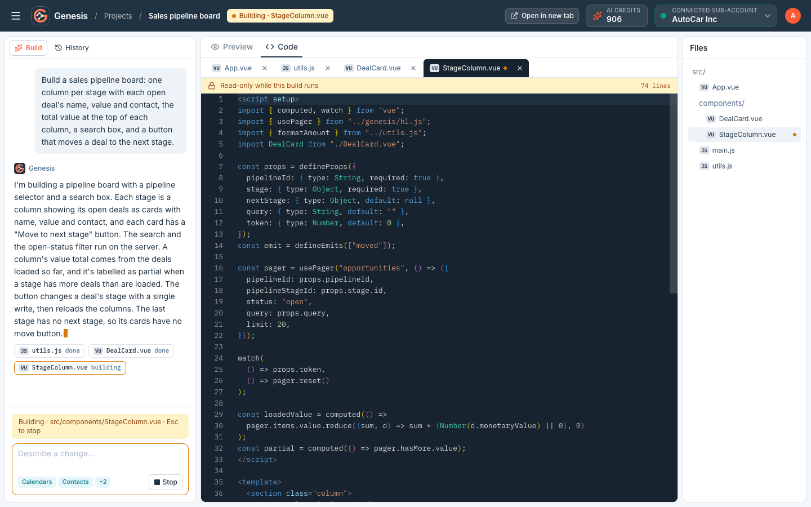
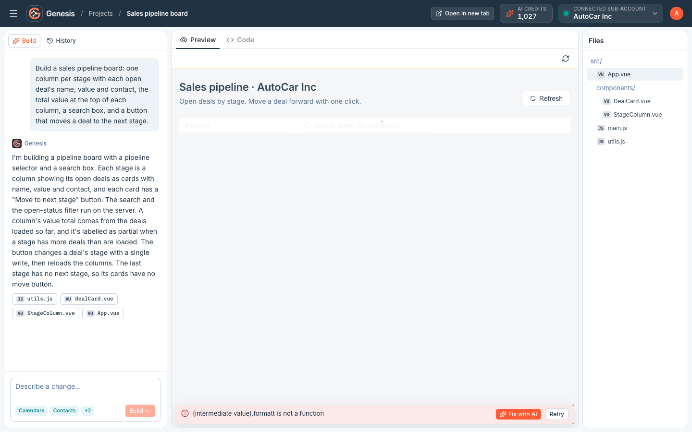
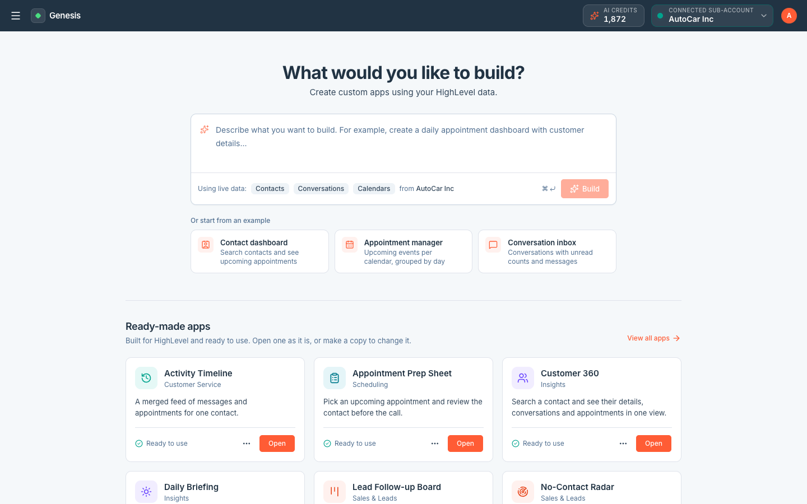
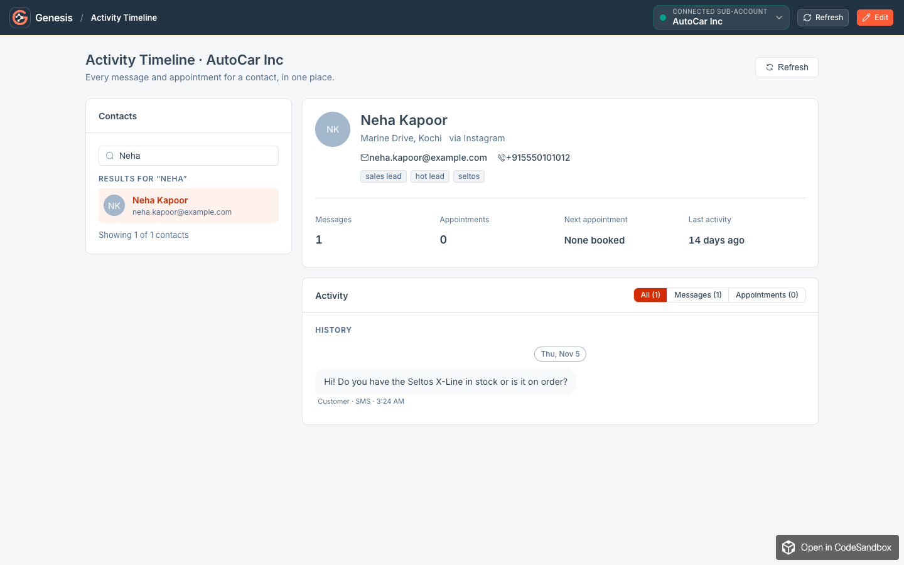
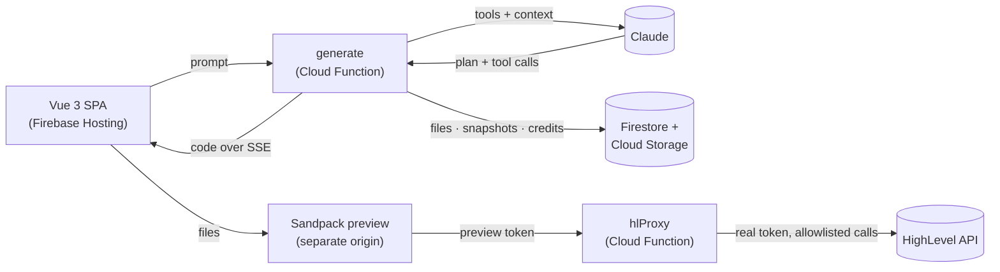
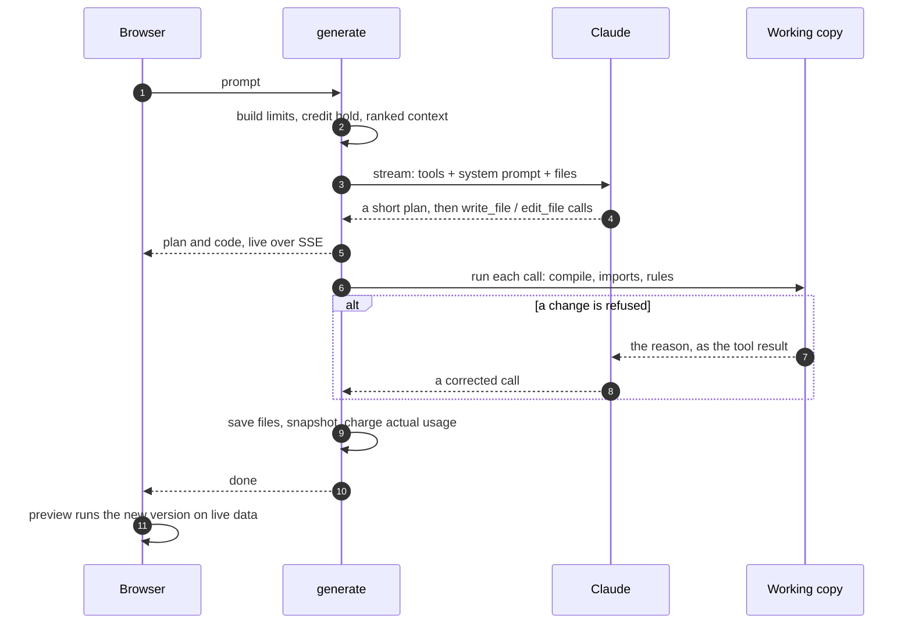

<h1 align="center">
  <br>
  Genesis
</h1>

<p align="center">
  <b>Describe an app in plain English. Watch Claude write it. Run it on your real HighLevel data.</b>
</p>

<p align="center">
  <a href="https://github.com/nirmalbenny/genesis/actions/workflows/deploy.yml"></a>
  <a href="https://genesisaibuilder.web.app"></a>
  
  
  
  
  
</p>

<p align="center">
  <a href="https://genesisaibuilder.web.app"><b>Live app</b></a> ·
  <a href="docs/ARCHITECTURE.md"><b>Architecture</b></a> ·
  <a href="#quick-start"><b>Quick start</b></a> ·
  <a href="#how-it-works"><b>How it works</b></a> ·
  <a href="#measured-quality"><b>Measured quality</b></a>
</p>


Genesis is an AI app builder for [HighLevel](https://www.gohighlevel.com). Connect a sub-account, describe what your team needs, and Genesis streams the code from Claude into a live editor, checks it, and runs the result in a sandboxed preview on your real contacts, conversations and calendars. Your HighLevel token never reaches the browser.

## Contents

- [Features](#features)
- [Screenshots](#screenshots)
- [How it works](#how-it-works)
- [Measured quality](#measured-quality)
- [Tech stack](#tech-stack)
- [Quick start](#quick-start)
- [Configuration](#configuration)
- [Scripts and tests](#scripts-and-tests)
- [HighLevel setup](#highlevel-setup)
- [Deployment](#deployment)
- [Design decisions](#design-decisions)
- [AI, security and limits at a glance](#ai-security-and-limits-at-a-glance)
- [Roadmap](#roadmap)
- [Troubleshooting](#troubleshooting)
- [License](#license)

## Features

### Build

- **Prompt-first:** describe an app, name it, and watch the plan and the code stream in, file by file, into a read-only Monaco editor.
- **Checked before it's saved:** every file must compile, and imports must resolve across the app. A change that fails goes back to Claude, which fixes it within the same build.
- **Refine:** follow-up prompts edit passages instead of rewriting files, so small changes are fast and cheap. Manual edits refresh the preview right away.
- **Fix with AI:** when the preview hits an error, one click sends it (with file and line) to Claude as a follow-up.
- **Stop any time:** Stop or Esc ends the build. Finished files are kept, the half-written one is discarded, and only the tokens used are charged.
- **History:** every build is a snapshot with an AI-written summary; any snapshot can be restored, non-destructively.

### Run

- **Real data:** generated apps read and write contacts, conversations, calendars and opportunities: create and update contacts (tags and notes too), book, reschedule and cancel appointments, mark conversations read or starred, send SMS or email, move deals through pipeline stages. Deletes are never allowed.
- **Paginated by design:** lists load 20 at a time behind Load more, with server-side search and counts that cover all the data.
- **One look:** apps are built from 66 injected components with shadcn-vue's API on Genesis's own UI kit, so they look consistent and Claude writes almost no CSS. Ask for another look and it restyles.
- **Ready-made apps:** six for every user (Customer 360, Daily Briefing, Appointment Prep Sheet, No-Contact Radar, Lead Follow-up Board, Activity Timeline): launch, copy to edit, or pin to the sidebar.

### Trust

- **Tokens stay on the server:** OAuth 2.0 tokens are sealed with Cloud KMS envelope encryption and refreshed safely. Apps reach HighLevel only through a proxy with a 15-minute preview token and an allowlist.
- **AI credits:** 2,500 on email verification (1 credit = $0.001 of Claude list price). Each build holds its worst case up front and pays what it used; every grant, hold and charge is in a ledger.
- **Guard rails:** email verification and reCAPTCHA Enterprise on every account, exact build limits, per-user rate limits, and off-topic or harmful prompts declined and never stored.

## Screenshots

| Code streams in, file by file | The build overlay keeps you posted |
|---|---|
|  |  |
| **Fix with AI from any preview error** | **Ready-made apps, catalog and launch** |
|  |  |
| **A prompt-first home** | **Ready-made app on live data** |
|  |  |

## How it works



One build, step by step:



- **Build:** every change Claude makes is a tool call with a strict schema. `generate` parses each one strictly, checks it on a working copy, streams the code to the editor as it's written, and saves everything at the end as one snapshot.
- **Run:** the preview runs the files in Sandpack. Generated apps import an injected HighLevel client and UI kit, and call HighLevel only through `hlProxy`, which adds the real token on the server.
- **Store:** clients read their own data straight from Firestore; every write goes through Cloud Functions. File content lives in Cloud Storage behind a manifest.

The [architecture document](docs/ARCHITECTURE.md) has the full system diagram (all six functions, shared modules, data stores, keys and CI), the data model, the API and every flow.

## Measured quality

A build eval ([`scripts/eval-builds.mjs`](scripts/eval-builds.mjs)) runs fixed prompts against the local stack with real Claude: new apps, follow-ups, a large app that needs `read_files`, a forbidden `package.json` change, an off-topic request, a Stop and a feature the preview can't compile. Every saved file is compiled. Moving from a tagged-text format to tool calls (2026-11-18):

| Per build | Tagged text (before) | Tool calls (now) |
|---|---|---|
| Builds that passed | 31 of 32 | all (22 of 22, and all 13 cases on the final code) |
| Saved files that don't compile | 1 of 100 | 0 |
| Output tokens | 2,746 | 2,096 (−24%) |
| AI credits | 40.7 | 35.2 (−14%) |
| Time | 17.6 s | 15.0 s (−15%) |
| Small follow-up | ~26 credits, ~10 s | ~15 credits, ~5 s |

Details and per-case numbers: [the tool-protocol plan](docs/plans/tool-protocol.md#14-results).

## Tech stack

| Layer | Choice |
|---|---|
| Frontend | Vue 3, TypeScript, Vite, **shadcn-vue** (Tailwind v4, reka-ui), `@lucide/vue`, `vue-router` |
| Editor and preview | `@guolao/vue-monaco-editor`, `@codesandbox/sandpack-client` |
| Backend | Firebase Auth (Identity Platform), Firestore, Cloud Storage, Cloud Functions 2nd gen on **Node 24**, TypeScript |
| AI | Claude via `@anthropic-ai/sdk`: **Sonnet 5.5** builds (streamed tool calls), **Haiku 5.5** writes snapshot summaries; `@vue/compiler-sfc` checks the code |
| HighLevel | OAuth 2.0 (sub-account), Contacts, Conversations and Calendars APIs: reads plus allowlisted writes, no deletes |
| Security | reCAPTCHA Enterprise, Cloud KMS (token encryption), Secret Manager, Workload Identity Federation |
| Quality | `node:test` (unit and emulator integration), Vitest, ESLint, a real-Claude build eval, GitHub Actions CI/CD |
| Observability | Langfuse (one trace per build, no code), structured logs in Cloud Logging |

## Quick start

**You need:** Node 24, Java 21+ (for the Firestore emulator), the Firebase CLI (`npm i -g firebase-tools`), [`cloudflared`](https://developers.cloudflare.com/cloudflare-one/connections/connect-networks/downloads/) (`brew install cloudflared`), a HighLevel Marketplace app ([setup](#highlevel-setup)) and an Anthropic API key.

1. **Install**

   ```bash
   git clone https://github.com/nirmalbenny/genesis.git && cd genesis
   (cd functions && npm install) && (cd frontend && npm install)
   firebase use <project-id>          # or edit .firebaserc
   ```

2. **Configure.** Every variable is described in [`.env.example`](.env.example) and in [Configuration](#configuration).

   ```bash
   cp functions/.env.example functions/.env          # ANTHROPIC_MODEL, ANTHROPIC_SUMMARY_MODEL
   # functions/.env.local      HL_REDIRECT_URI=http://127.0.0.1:5001/<project-id>/us-central1/hlAuthCallback
   #                           APP_URL=http://localhost:5173
   #                           LOCAL_TOKEN_KEK=<openssl rand -base64 32>
   #                           FILE_STORE=blobs  CONTEXT_TOOLS=on  TRACING=off
   # functions/.secret.local   ANTHROPIC_API_KEY=…  HL_CLIENT_ID=…  HL_CLIENT_SECRET=…  PREVIEW_TOKEN_SECRET=<openssl rand -hex 32>
   #                           LANGFUSE_PUBLIC_KEY=…  LANGFUSE_SECRET_KEY=…   (any value while TRACING=off)
   cp frontend/.env.example frontend/.env.local      # Firebase web config; VITE_USE_EMULATORS=true
   ```

3. **Run** in two terminals:

   ```bash
   firebase emulators:start           # auth :9099 · firestore :8080 · storage :9199 · functions :5001 · UI :4000
   cd frontend && npm run dev         # a tunnel to :5001, then Vite on http://localhost:5173
   ```

4. **Use it:** open <http://localhost:5173> and sign up. Click the verification link in the Auth emulator (Emulator UI on port 4000), choose **Connect HighLevel** and pick your sandbox sub-account, then describe an app.

> [!NOTE]
> **Why `npm run dev` opens a tunnel:** Chrome's Local Network Access protection blocks the Sandpack preview, which runs on a public origin, from calling `127.0.0.1`. [`frontend/scripts/dev.mjs`](frontend/scripts/dev.mjs) opens a Cloudflare quick tunnel to the functions emulator, waits until it's reachable, and starts Vite with `VITE_FUNCTIONS_BASE_URL` set to it. Ctrl+C stops both; quick-tunnel URLs change on every start. `npm run dev:local` is plain Vite. Deployed builds don't need any of this.

## Configuration

| Variable | Where | Purpose |
|---|---|---|
| `ANTHROPIC_MODEL` | `functions/.env` | Claude model for builds |
| `ANTHROPIC_SUMMARY_MODEL` | `functions/.env` | Small model for one-line snapshot summaries (default `claude-haiku-5-5`) |
| `HL_REDIRECT_URI` | `functions/.env.local` · `.env.<project-id>` | OAuth callback URL; must be registered in the HighLevel app |
| `APP_URL` | `functions/.env.local` · `.env.<project-id>` | Where the OAuth callback sends the browser back |
| `LOCAL_TOKEN_KEK` | `functions/.env.local` | Emulator-only key that encrypts stored HighLevel tokens (`openssl rand -base64 32`); production uses Cloud KMS |
| `FILE_STORE` | `functions/.env.local` · GitHub variable | `firestore` (default: a document per file) or `blobs` (Cloud Storage + manifest, used in production). See [ARCHITECTURE §3.1](docs/ARCHITECTURE.md#31-project-files-blobs-and-a-manifest) |
| `CONTEXT_TOOLS` | `functions/.env.local` · GitHub variable | `on` (default): large apps get a file index and builds have the `read_files` tool; `off` is a kill switch |
| `BLOB_CLEANUP` | GitHub variable | `dry-run` (default: the daily cleanup only logs) or `delete` |
| `READ_SCOPES` | `functions/.env.local` · GitHub variable | `log` (default): a read whose HighLevel scope the connection lacks is served and logged (`hl.read_scope_missing`); `enforce` refuses it. Writes always need their scope |
| `TRACING` | `functions/.env.local` · GitHub variable | `off` (default) or `langfuse`: one trace per build ([ARCHITECTURE §14](docs/ARCHITECTURE.md#14-observability)) |
| `LANGFUSE_BASE_URL` | `functions/.env.local` · GitHub variable | `https://cloud.langfuse.com` (EU, default) or `https://us.cloud.langfuse.com` (US) |
| `ANTHROPIC_API_KEY` | secret | Claude API key |
| `HL_CLIENT_ID`, `HL_CLIENT_SECRET` | secret | HighLevel Marketplace app credentials |
| `PREVIEW_TOKEN_SECRET` | secret | HMAC key for the 15-minute preview tokens |
| `LANGFUSE_PUBLIC_KEY`, `LANGFUSE_SECRET_KEY` | secret | Langfuse project keys; required by every deploy, even while tracing is off |
| `VITE_FIREBASE_*` | `frontend/.env.local` · `.env.production` | Firebase web app config (public by design) |
| `VITE_FUNCTIONS_BASE_URL` | `frontend/.env.*` | Functions base URL; set automatically by `npm run dev` |
| `VITE_USE_EMULATORS` | `frontend/.env.*` | `true` locally, `false` in production |

- **Secrets** go in `functions/.secret.local` for the emulator and in **Secret Manager** in production, never in a `.env` file.
- **Flags in production** come from GitHub repository variables of the same names: CI writes them into `functions/.env.<project-id>` on every deploy. Unset means the default; to change one, set the variable and re-run the deploy.
- Every real config file is git-ignored; only the `*.example` templates are tracked.

## Scripts and tests

| Where | Command | What it does |
|---|---|---|
| `frontend/` | `npm run dev` | Tunnel plus Vite dev server |
| `frontend/` | `npm run build` | Type-check (`vue-tsc`) and production build into `dist/` |
| `frontend/` | `npm test` | Vitest: the SSE reader and the build state machine; the injected client, UI kit and components (doc sync, add-only, rendering, preview-compiler limits); every ready-made app compiles |
| `frontend/` | `npm run lint` | ESLint (Vue + TypeScript) |
| `functions/` | `npm test` | Unit tests: the tool loop and stream assembly, tool-input streaming, the workspace and code checks, context ranking, credits, rate limits, token encryption, file manifests, templates, traces |
| `functions/` | `npm run test:e2e` | Integration tests on the emulators: auth gate, projects, isolation between users, snapshots, the file store, build limits, cancel, the proxy, and the security rules. Never calls Claude or HighLevel |
| `functions/` | `npm run migrate:files -- --bucket <bucket> [--dry-run]` | Backfills every project into Storage + manifests (resumable, verified) |
| `functions/` | `npm run hl:probe -- <resource> --email <account>` | Checks a HighLevel resource in `hl-resources/` against the real sandbox through the local proxy (every read, each list paged to its end), records anonymized fixtures and compares the guide with the real fields. Emulators only |
| `functions/` | `npm run measure:files` | Times both file stores on the emulators |
| `functions/` | `npm run lint` | ESLint (TypeScript) |
| repo root | `node scripts/eval-builds.mjs <label> [case…]` | Build eval: 13 real builds against the running emulators (real Claude, about $1), each saved file compiled; results in `eval-results.jsonl` |
| repo root | `node scripts/check-docs.mjs` | Docs check: markdownlint, every local link and anchor, and that every Mermaid diagram renders |

CI runs lint, unit and integration tests and the production build on every push and pull request (the integration tests on a throwaway `demo-` project). **Claude Code skills** in [`.claude/skills/`](.claude/skills) automate the routine work: `/verify` (definition of done), `/hl-resource`, `/new-template`, `/docs-check` and `/prod-check`.

## HighLevel setup

1. **Create a Marketplace app** at [marketplace.gohighlevel.com](https://marketplace.gohighlevel.com) at **Sub-account** (Location) level, with exactly these scopes (the consent screen lists every scope enabled on the app):

   ```text
   contacts.readonly contacts.write conversations.readonly conversations.write
   conversations/message.readonly conversations/message.write
   calendars.readonly calendars/events.readonly calendars/events.write locations.readonly
   opportunities.readonly opportunities.write
   ```

   `locations.readonly` is only used to show the connected sub-account's name.
2. **Copy the Client ID and Client Secret** into the secrets. The authorize URL includes `version_id`, derived from the client ID; without it HighLevel returns "No integration found".
3. **Add both redirect URIs** under Advanced Settings → Auth:
   - production: `https://us-central1-<project-id>.cloudfunctions.net/hlAuthCallback`
   - local: `http://127.0.0.1:5001/<project-id>/us-central1/hlAuthCallback`
4. **Create a sandbox sub-account** from the developer dashboard and add contacts, conversations, appointments and calendar availability, so the preview has real data to show.

## Deployment

**Live:** app <https://genesisaibuilder.web.app> · functions `https://us-central1-genesisaibuilder.cloudfunctions.net` (`api`, `generate`, `hlProxy`, `hlAuthStart`, `hlAuthCallback`, and the scheduled `cleanupFileBlobs`) · Loom walkthrough: _to come_.

**Continuous deployment.** [`.github/workflows/deploy.yml`](.github/workflows/deploy.yml) checks every push and pull request (lint, unit tests, emulator integration tests, frontend type-check and build). Pushes to `main` then deploy with `firebase deploy --only functions,hosting,firestore,storage`, authenticated with **Workload Identity Federation**, so there are no keys. Pushes that change only Markdown, `docs/` or `.env.example` don't run. Config comes from GitHub repository variables (`FIREBASE_PROJECT_ID`, `VITE_FIREBASE_*`, `ANTHROPIC_MODEL`, `ANTHROPIC_SUMMARY_MODEL`, `WIF_PROVIDER`, `DEPLOY_SERVICE_ACCOUNT` and the flags above); secrets stay in Secret Manager.

<details>
<summary><b>One-time project setup</b></summary>

- **Blaze plan,** required for 2nd-gen functions and Secret Manager. Set a budget alert.
- **Token encryption:** run `./scripts/setup-token-encryption.sh <project-id>` **before the first deploy**. It enables Cloud KMS, creates the `genesis/hl-tokens` key (manual rotation) and lets only the functions' service account use it.
- **Authentication:** enable Email/Password, then `./scripts/setup-bot-protection.sh <project-id>`. It upgrades Auth to Identity Platform (free up to 50k monthly users; can't be undone) and scores every sign-up and sign-in with reCAPTCHA Enterprise, blocking scores ≤ 0.3. Pass `AUDIT` as the second argument to score without blocking, or `OFF` to turn it off.
- **Firestore:** Standard edition, Native mode.
- **Cloud Storage:** enable Firebase Storage (production mode) to create the default bucket. For the daily cleanup, also enable the Cloud Scheduler API.
- **CI:** `./scripts/setup-github-deploy.sh <project-id> <owner/repo>` (needs `gcloud` as a project owner and `gh`). It creates a `github-deployer` service account with deploy-only roles and a workload identity provider that trusts only this repo's `main` branch, and stores `WIF_PROVIDER` and `DEPLOY_SERVICE_ACCOUNT` as repository variables. To require approval before each deploy, add reviewers to the `production` environment.
- **Secrets:** `firebase functions:secrets:set ANTHROPIC_API_KEY` (and `HL_CLIENT_ID`, `HL_CLIENT_SECRET`, `PREVIEW_TOKEN_SECRET`, `LANGFUSE_PUBLIC_KEY`, `LANGFUSE_SECRET_KEY`).
- **After the first deploy:** register the deployed `hlAuthCallback` URL in the HighLevel app, then smoke test: sign up → connect → prompt → watch it stream → live data in the preview → edit a file → restore a snapshot.

</details>

<details>
<summary><b>Manual deploy</b></summary>

```bash
firebase use <project-id>
# Production params (git-ignored):
#   functions/.env.<project-id>   HL_REDIRECT_URI=https://us-central1-<project-id>.cloudfunctions.net/hlAuthCallback
#                                 APP_URL=https://<project-id>.web.app
#   frontend/.env.production      Firebase web config, VITE_FUNCTIONS_BASE_URL=https://us-central1-<project-id>.cloudfunctions.net,
#                                 VITE_USE_EMULATORS=false
(cd frontend && npm run build)
firebase deploy --only functions,hosting,firestore,storage   # what CI deploys
```

On a first deploy, one function can fail with a 409 ("Could not create bucket gcf-v2-sources-…") while the functions race to create the source bucket; the CLI retries, or run `firebase deploy --only functions:generate`. If the CLI "could not set up cleanup policy", run `firebase functions:artifacts:setpolicy --location us-central1 --days 1`.

</details>

<details>
<summary><b>Switching project files to Cloud Storage</b> (each step a separate deploy)</summary>

1. With the defaults (`FILE_STORE` unset = `firestore`), files stay in Firestore.
2. Set up Cloud Storage and Cloud Scheduler as above. The daily cleanup deploys in dry-run mode; users see no change.
3. Optional: backfill so no app is converted on first open: `GCLOUD_PROJECT=<project-id> npm run migrate:files -- --bucket <bucket> --dry-run`, then the same with `--allow-production`. Re-running is safe.
4. Set the repository variable `FILE_STORE=blobs` and re-run the deploy. Apps not yet converted are converted when first opened.
5. After a week, check the cleanup's dry-run logs, then set `BLOB_CLEANUP=delete`.

</details>

<details>
<summary><b>Build tracing with Langfuse</b></summary>

Create a Langfuse project (the free plan works), store its two keys as the secrets above, and set the repository variables `TRACING=langfuse` and, for the US region, `LANGFUSE_BASE_URL=https://us.cloud.langfuse.com`. Traces carry prompts, plans, file names, tokens and costs, never code. To turn tracing off, set `TRACING=off` and re-run the deploy. Langfuse processes prompts and plans, so list it in your privacy policy.

</details>

## Design decisions

1. **Generated apps never see the HighLevel token.** They call `hlProxy` with a 15-minute HMAC preview token tied to the user, app and location. The proxy allows only listed reads and writes (never deletes), rejects tokens whose app was deleted or isn't the user's, forces the `locationId`, checks the connection granted the write's scope, and attaches the real token on the server.
2. **Every change is a tool call.** `write_file`, `edit_file`, `delete_file`, `read_files` and `decline`, with strict schemas. The loop reads the raw stream and parses each tool input strictly, never guessing; file content still streams into the editor as Claude writes it. A text format parsed out of the stream was measured to let tool-call markup leak into files.
3. **Nothing is saved that doesn't compile.** Each write and edit is compiled with `@vue/compiler-sfc` (pinned to the frontend's Vue), and imports are checked across the app after each response. Refusals go back to Claude as the tool's result, so it fixes them within the build.
4. **Partial results are always kept.** Valid changes survive refused ones, an interrupted stream keeps every completed file, and each build ends in a snapshot with a one-line Haiku summary. Restoring is non-destructive.
5. **Firestore is read by the client, written only by Cloud Functions.** Security rules allow owner-only reads and reject every client write, so all validation stays on the server.
6. **File content is content-addressed in Cloud Storage behind a manifest.** Content goes up first and one transaction switches the manifest, so a change is never half-applied; snapshots are manifest copies, and identical content is stored once per user.
7. **HighLevel tokens are encrypted at rest and refreshed safely.** A fresh AES-256-GCM key per record, wrapped by a Cloud KMS key that never leaves KMS. Refresh tokens are single-use, so concurrent refreshes are funnelled into one request per instance.
8. **The model's context is bounded and ranked.** Files within a character budget (in a large app, the files the request most likely touches first, the rest as an index Claude can read from), the last 6 messages, and a hand-written HighLevel reference verified against a live sandbox. The prompt makes pagination mandatory and forbids hard-coded location IDs and sample data.
9. **One prompt cache for everyone.** The tool definitions and system prompt (about 7,800 tokens) are frozen and identical for every user, so any build within 5 minutes of another reads them at a tenth of the price.
10. **Generated apps share an injected client, UI kit and components,** never saved and live for every app at once, so they only ever grow (add-only, enforced by tests).
11. **SSE over `fetch` with a `ReadableStream`,** because the request needs POST and an Authorization header: a defined event protocol, a 15-second heartbeat and a hand-written reader, with no extra library.

## AI, security and limits at a glance

| AI | |
|---|---|
| Models | **Sonnet 5.5** writes apps, **Haiku 5.5** writes snapshot summaries; set in config, never chosen by users |
| Streaming | The plan and every file stream to the editor over SSE as they're written; Stop or Esc ends the build at once |
| Context | System prompt, HighLevel reference, up to 60,000 characters of the app's files (most relevant first, the rest indexed and readable with `read_files`) and the last 6 messages. Prompts ≤ 4,000 characters, output ≤ 16,000 tokens per build |
| Grounding | Generated apps use the injected client for every HighLevel call, paginate, never invent data, and write only from an explicit user action |
| Safety | Off-topic, harmful or rule-breaking prompts are declined (the `decline` tool or the API's refusal) and **never stored** |
| Cost | Credits held at the worst case from an exact token count, then settled to actual usage; a shared prompt cache |
| Observability | One [Langfuse](https://langfuse.com) trace per build (requests, tokens, cost, tool calls, saves) grouped by app, and structured `build.*` logs. Never code |

| Security | |
|---|---|
| Accounts | Email verification required before any endpoint works; **reCAPTCHA Enterprise** on every sign-up and sign-in |
| HighLevel tokens | Never sent to the browser; **Cloud KMS envelope encryption**, bound to the user; refreshed safely under concurrency |
| Generated apps | Run in a **sandboxed iframe on another origin**; reach HighLevel only through `hlProxy` with a 15-minute preview token |
| Data | Firestore rules: **owner-only reads, no client writes**; Storage rules deny all client access; CORS limited to the app's origins |
| Secrets | Secret Manager in production, git-ignored files locally; CI deploys **without keys** |

| Limits | Per | How |
|---|---|---|
| 1 build at a time per app, 2 per user | user | Build slots in Firestore, next to the credit hold |
| 10 build starts per 10 minutes | user | Sliding-window log, exact wait time |
| Generated apps → HighLevel: 20 requests/s, bursts of 40 | user | Token bucket in `hlProxy` |
| 30 writes/min; message sends 10/min per user, ~200/day per sub-account | user, sub-account | Token buckets |
| Repeated reads cached 10 s; pause while HighLevel says to back off | sub-account | Cache and 429 back-off |
| `api`: 60 changes/min, 300 reads/min | user | Token bucket |

A refused build never counts tokens, holds credits or calls Claude. Details: [generation pipeline](docs/ARCHITECTURE.md#6-generation-pipeline), [AI credits](docs/ARCHITECTURE.md#7-ai-credits), [rate limiting](docs/ARCHITECTURE.md#8-rate-limiting) and the [security model](docs/ARCHITECTURE.md#11-security-model), including what each control does and doesn't protect against.

## Roadmap

1. **Diff view:** show what each build changed; snapshots are manifests, so it's a comparison of two documents.
2. **Render before saving:** mount each new version headlessly against stubbed data and send runtime errors back to Claude, as compile errors are today.
3. **HighLevel webhooks:** a receiver with Ed25519 signature checks, so apps such as a live inbox update in real time, and `AppUninstall` deletes stored tokens at once.
4. **Security lint for generated code:** reject `v-html`, `eval`, `document.cookie` and network calls that bypass the proxy.
5. **Per-app write permissions:** let users choose which apps may write to HighLevel, with an optional approval step for message sends.
6. **Shared rate limiting at scale:** move the in-memory token buckets to Redis for exact limits across instances, with Cloud Armor and App Check at the edge.

## Troubleshooting

<details>
<summary>Common problems and fixes</summary>

| Symptom | Fix |
|---|---|
| The preview shows "Failed to fetch" locally | Use `npm run dev`, not `dev:local`: Chrome blocks the preview from calling `127.0.0.1` directly |
| The app hangs locally after working earlier | The quick tunnel expired; restart `npm run dev` for a fresh URL |
| HighLevel says "No integration found with the id" | The authorize URL needs `version_id`, which Genesis adds; check `HL_CLIENT_ID` |
| HighLevel rejects the redirect | The redirect URI must match `HL_REDIRECT_URI` exactly, with `https` and no trailing slash |
| "HighLevel credentials can't be read right now" (`hl_tokens_unavailable`) | Production: run `scripts/setup-token-encryption.sh` and check the functions' service account can use the key. Locally: set `LOCAL_TOKEN_KEK` |
| The emulators refuse to start with a Java error | Install JDK 21 or newer (`brew install openjdk@21`) and put it on your `PATH` |
| Deploy fails with "Node.js 20 was decommissioned" | `functions/package.json` must use `"engines": { "node": "24" }` |
| A ready-made app shows "Connect a sub-account first" | Connect HighLevel from the top bar; apps always run on the connected sub-account |

</details>

<details>
<summary>Repository layout</summary>

```text
.
├── functions/                 Cloud Functions (TypeScript), see functions/README.md
│   ├── src/                   api · generate (SSE) · hlProxy · hl/ (OAuth, tokens) · files/ (Storage + manifests)
│   │                          llm/ (prompt, context, tools, tool loop, workspace, code checks) · observability/
│   │   ├── *.test.ts          unit tests (npm test)
│   │   └── e2e/               integration tests against the emulators (npm run test:e2e)
│   └── templates/             six ready-made apps (templates.json + <slug>/src/**)
├── frontend/                  Vue 3 SPA, see frontend/README.md
│   ├── src/                   views · components (ui/ = shadcn-vue) · composables · lib
│   │   └── sandbox/genesis/   injected into every preview: HighLevel client, UI kit, components
│   └── scripts/dev.mjs        npm run dev: Cloudflare tunnel + Vite
├── scripts/                   one-time GCP setup, eval-builds.mjs (build eval), check-docs.mjs
├── docs/
│   ├── ARCHITECTURE.md        goals, system design, data model, API, flows, credits, limits, security, testing
│   ├── plans/                 change plans with their verification and measurements
│   └── screenshots/
├── .github/workflows/         deploy.yml: checks on every push and PR, deploy on main
└── firebase.json · firestore.rules · firestore.indexes.json · storage.rules · .env.example
```

</details>

## License

This repository is a take-home submission for HighLevel. No open-source license is granted: all rights are reserved by the author.
