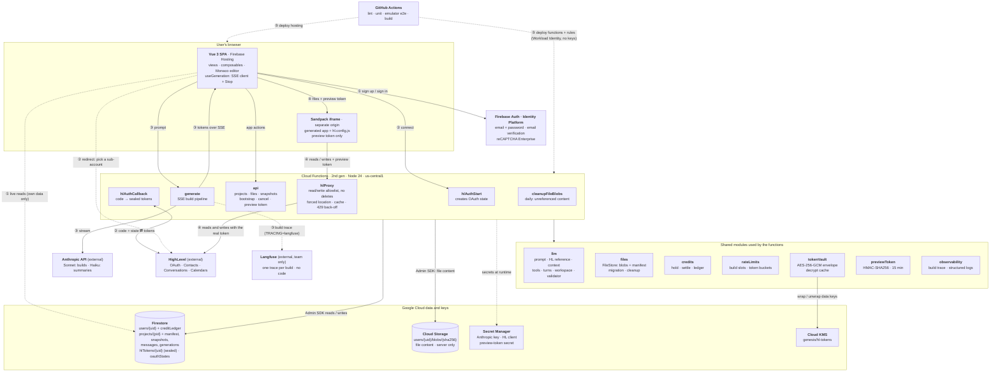
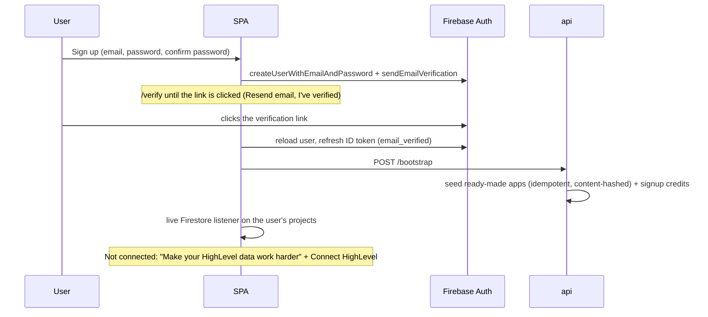
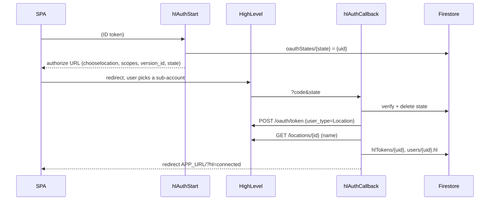
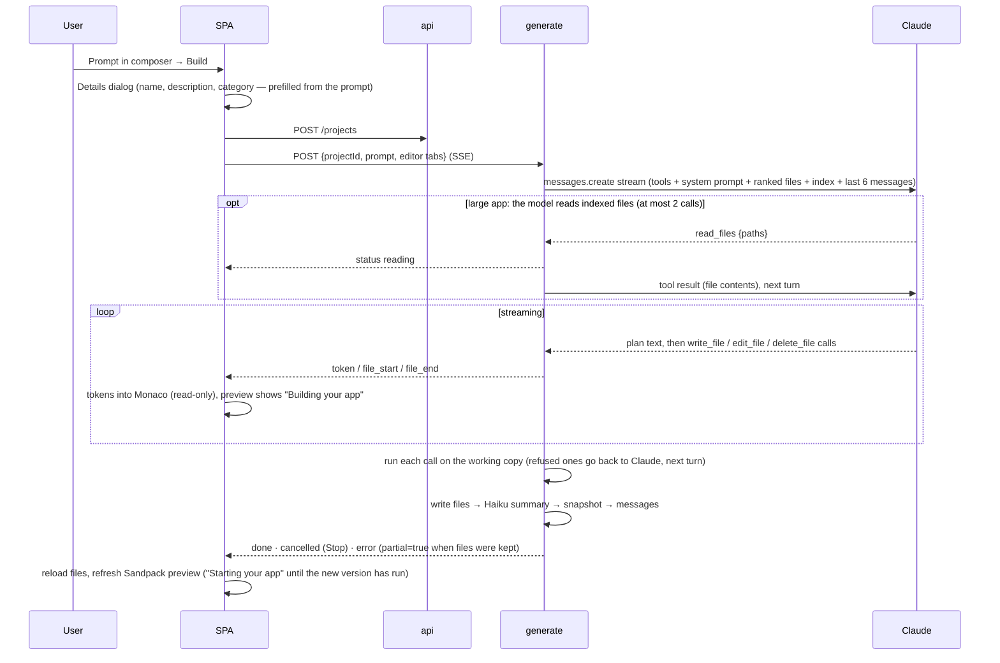
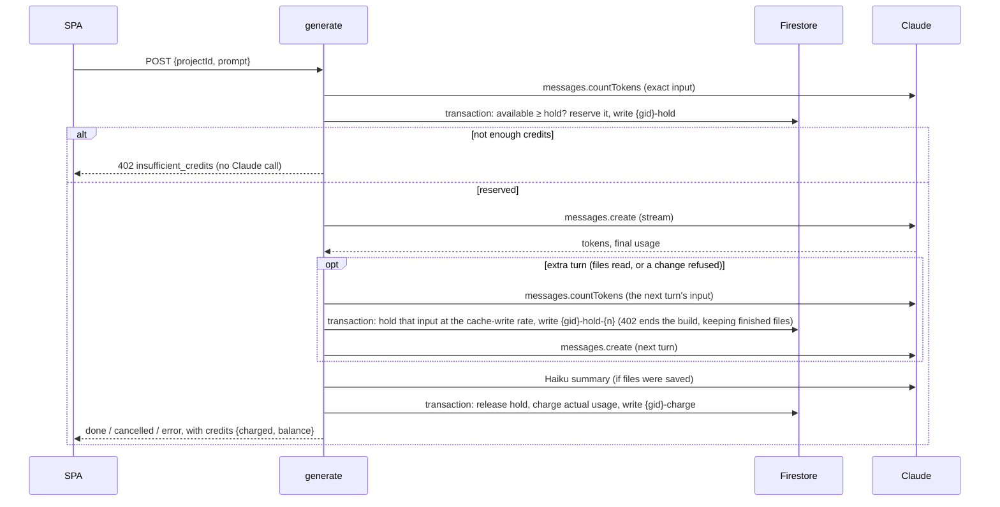
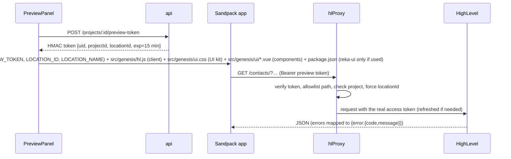

# Genesis — Architecture and flows

Genesis is an AI app builder for HighLevel. A user connects a HighLevel sub-account, describes an app in plain English, watches Claude stream the code into an editor, and runs the result on their live contacts, conversations and calendars.

This document covers the product goals, the system design, the data model, and each main flow. The [README](../README.md) covers setup and deployment.

## Contents

1. [Goals](#1-goals)
2. [System overview](#2-system-overview)
3. [Data model](#3-data-model)
4. [Backend API](#4-backend-api)
5. [Flows](#5-flows)
6. [Generation pipeline](#6-generation-pipeline)
7. [AI credits](#7-ai-credits)
8. [Rate limiting](#8-rate-limiting)
9. [Ready-made apps](#9-ready-made-apps)
10. [Live data, preview and pagination](#10-live-data-preview-and-pagination)
11. [Security model](#11-security-model)
12. [Frontend structure](#12-frontend-structure)
13. [Testing](#13-testing)
14. [Observability](#14-observability)

---

## 1. Goals

| Goal | How Genesis meets it |
|---|---|
| Apps built on **real HighLevel data** | Generated apps call the Contacts, Conversations and Calendars APIs through a proxy and show live records. They never use sample data. |
| **Streaming** generation | Claude's output streams token by token over SSE into a read-only Monaco editor. The preview shows a "Building your app" overlay meanwhile. |
| **Safe by default** | Generated apps never see the HighLevel token, and reach HighLevel only through an allowlist of reads and writes with no deletes. Every Firestore write goes through Cloud Functions. |
| **Nothing is lost** | Every generation creates a restorable snapshot. Interrupted or partly invalid output keeps every file that completed. |
| **Useful on day one** | Every user gets six locked, ready-made apps. Users can launch them, copy them and pin them to the sidebar. |
| **Graceful failure** | Malformed model output, interrupted streams, failed HighLevel calls, declined requests and a missing connection each produce a clear message. |

Non-goals: deleting HighLevel data, multiple connected sub-accounts per user (the assignment requires one), and deployment pipelines for generated apps.

## 2. System overview



| Flow | What happens | Details |
|---|---|---|
| ① Sign in | Firebase Auth (with reCAPTCHA Enterprise) signs the user in; until the email is verified, nothing else works. The SPA then reads its own data live from Firestore. | §5.1 |
| ② Connect HighLevel | `hlAuthStart` creates a one-time state, the user picks a sub-account on HighLevel, and `hlAuthCallback` exchanges the code and stores the tokens sealed with Cloud KMS. | §5.2, §11.1 |
| ③ Build | `generate` checks the build limits, picks the files to send (a large app also gets an index the model can read from), holds credits, and streams Claude's tool calls: each change is checked (it must compile) and its code streams to the editor over SSE. Then it saves the files, a snapshot and the charge. | §5.3, §6–8 |
| ④ Preview on live data | `api` issues a 15-minute preview token; the generated app in Sandpack calls `hlProxy`, which opens the sealed token and calls HighLevel with it. | §10 |
| ⑤ Deploy | GitHub Actions runs lint, unit and emulator tests, then deploys hosting, functions and rules with Workload Identity Federation. | README |

Everything runs in one Firebase project in `us-central1`. Clients never write to Firestore, never touch Cloud Storage, and never see a HighLevel token or a secret.

| Function | Auth | Responsibility |
|---|---|---|
| `hlAuthStart` | Firebase ID token | Creates a one-time OAuth `state` and returns the HighLevel authorize URL. |
| `hlAuthCallback` | Public (verified by `state`) | Exchanges the code, stores the tokens encrypted (§11.1), fetches the location name, then redirects back to the app. |
| `api` | Firebase ID token | A small router for projects, files, snapshots, ready-made apps, pinning, preview tokens and disconnect (see §4). |
| `generate` | Firebase ID token | Streaming generation over SSE (see §6), with the credit hold (§7) and build limits (§8). |
| `hlProxy` | Preview token | Forwards allowlisted reads and writes (never deletes) to HighLevel using the user's real token (see §10). |
| `cleanupFileBlobs` | Scheduled, daily | Deletes file content no manifest references, after a 7-day grace period (§3.1). Dry run unless `BLOB_CLEANUP=delete`. Needs the Cloud Scheduler API and the deploy account's scheduler role. |

## 3. Data model

```text
users/{uid}
  email               (recorded when HighLevel is connected)
  hl: { locationId, locationName, companyId, location{email,phone,timezone}, connectedAt } | null   ← the active connection
  templatesVersion                                                  ← content hash of the ready-made app set the user has
  credits: { balance, reserved, granted, used }                     ← AI credits (1 credit = $0.001 of Claude list price)
  activeBuilds: { [generationId]: { projectId, startedAt } }        ← running builds (rate limit, §8)
  buildStarts: [ms timestamps]                                      ← build starts in the last 10 minutes (§8)
  creditLedger/{entryId}  type: grant|hold|charge, credits, generationId?, model?, usage?, rateCardVersion   (append-only)

hlTokens/{uid}        sealed{v, kek, wrappedDek, iv, tag, ciphertext}, expiresAt, locationId, scope   (no client access; tokens encrypted, §11)
oauthStates/{state}   uid, createdAt                                                   (no client access)

projects/{pid}
  ownerId, name, description, category, icon
  locationId          ← the sub-account the app last ran on (apps follow the current connection)
  kind: "user" | "prebuilt"
  templateSlug, templateVersion     (ready-made apps only; pid = "{uid}_{slug}")
  forkedFrom: { projectId, name }   (copies only)
  pinnedAt | null                   (pinned to the sidebar)
  createdAt, updatedAt, deletedAt | null   (soft delete)

  manifest: { [path]: { hash, size, lines, props[], emits[], imports[], hlHelpers[] } }   ← the app's files (§3.1)
  manifestVersion       ← +1 on every change
  messages/{mid}        role: user|assistant, content, generationId, createdAt
  generations/{gid}     prompt, status: streaming|done|partial|error|declined|cancelled, error?, snapshotId?, createdAt,
                        files[]   (paths the build changed; ranks the next builds' context, §6)
                        cancelRequested?   (set by the Stop button; the running build watches for it)
                        credits, usage{model, tokens}, summaryUsage?   (declined: no prompt, which is never stored)
  snapshots/{sid}       generationId|null, reason: generation|restore|template|copy, summary, fileCount, createdAt,
                        manifest   (the files at that point: a copy of the manifest, not of the files)
  files/{fileId}        path, content       (legacy: the Firestore store, FILE_STORE=firestore; kept until removal)
  snapshots/{sid}/files/{fileId}            (legacy, as above)

Cloud Storage (default bucket; storage.rules deny every client)
users/{uid}/blobs/{sha256}   file content, immutable, shared by all of that user's apps and snapshots
```

- **Security rules:** clients can read their own `users/{uid}` and any project they own, including its subcollections. Every write goes through Cloud Functions (Admin SDK). Tokens and OAuth states can't be read by any client. Cloud Storage is closed to clients entirely.

### 3.1 Project files: blobs and a manifest

Every read and write of files goes through one `FileStore` interface ([`files/`](../functions/src/files/index.ts)). The `FILE_STORE` parameter selects the storage: `blobs` (content in Cloud Storage plus a manifest, the target) or `firestore` (one document per file, the original, kept as the fallback until the old data is removed).

- **Content-addressed:** a file's content is stored once per user at `users/{uid}/blobs/{sha256}`. Unchanged files, snapshots and duplicated apps share it. Uploads are create-only (`ifGenerationMatch: 0`), and content the current manifest already references isn't uploaded again.
- **Manifest:** `projects/{pid}.manifest` maps each path to its hash and metadata (size, lines, props, emits, imports, HighLevel helpers used), extracted with regular expressions when the file is written. Builds rank and index files from it without reading content.
- **Changes:** new content is uploaded first, then one transaction applies the change to the manifest and increments `manifestVersion`. A failure before the transaction changes nothing visible; readers never see half a change. Concurrent changes to different files both land; `apply` can also require an expected version.
- **Snapshots** store a copy of the manifest in the same write as the snapshot, so they can't be half-saved, and their size no longer grows with the content. **Restore** replaces the manifest in a transaction and records a `restore` snapshot. **Copy** copies the manifest within one account.
- **Migration:** a project without a manifest is converted on first access (its Firestore files are uploaded; a transaction keeps one manifest if two first accesses race). A snapshot from before the migration is converted when it's restored. `npm run migrate:files` backfills every project and snapshot, verifying each file by downloading it again, and can be re-run. Firestore file data is never deleted by any of this. While `FILE_STORE=firestore`, every change drops the project's manifest, so a manifest made by an earlier backfill can't go stale.
- **Cleanup:** manual saves leave superseded content behind. `cleanupFileBlobs` reads every manifest first, then deletes blobs that no project or snapshot of that user references and that haven't been reused for 7 days. Reusing a blob bumps its `customTime` (and so its metageneration), and the delete carries the metageneration seen when listing, so a blob reused meanwhile is kept.
- **Cost:** a 44-file app's snapshot is one 10.7 KB document instead of 45; a manual save is one upload and one transaction. Measurements: [`docs/plans/filestore-and-context.md`](plans/filestore-and-context.md#8-measurements).

## 4. Backend API

All routes are on the `api` function and need `Authorization: Bearer <Firebase ID token>` for an account whose email is verified (otherwise `403 email_not_verified`; the same applies to `generate` and `hlAuthStart`). Errors are returned as `{ error: { code, message } }`. Every route is rate limited per user and can return `429 rate_limited` with `retryAfter` (§8).

| Method & path | Purpose |
|---|---|
| `POST /bootstrap` | Gives the user the current set of ready-made apps and the 2,500 signup credits. Safe to repeat. |
| `POST /hl/disconnect` | Deletes the user's HighLevel tokens and pending OAuth states, and clears `users.hl`. |
| `POST /projects` | Creates an app. `name` and `description` are required, `category` is optional. |
| `GET /projects/:id` | Returns the app's details. |
| `PATCH /projects/:id` | Changes name, description or category. Not allowed on ready-made apps. |
| `DELETE /projects/:id` | Soft delete. |
| `POST /projects/:id/duplicate` | Copies an app into a new editable app, with its name and description. |
| `POST /projects/:id/pin` | `{ pinned }`. Pins or unpins the app. Allowed on ready-made apps. |
| `GET /projects/:id/files` | Lists the files, or returns their contents with `?content=true`. |
| `GET /projects/:id/file?path=` | Reads one file. |
| `PUT /projects/:id/files` | Saves a manual edit after validating the path and size. Not allowed on ready-made apps. |
| `GET /projects/:id/snapshots` | Lists the 50 most recent snapshots, with summaries. |
| `POST /projects/:id/generations/:gid/cancel` | Stops a running build (sets `cancelRequested`). Returns `{ requested: false }` if the build already finished. |
| `POST /projects/:id/snapshots/:sid/restore` | Restores a snapshot, which itself records a new `restore` snapshot. Not allowed on ready-made apps. |
| `POST /projects/:id/preview-token` | Issues a 15-minute preview token for the connected location. |

The **`generate`** function takes `POST { projectId, prompt, activePath?, openPaths? }` (prompt ≤ 4,000 characters; the editor's tabs are hints for context ranking, at most 10, invalid paths ignored). Before streaming, it can refuse with JSON, for example `429 rate_limited` (builds running at once or started recently, §8) or `402 insufficient_credits` when the available balance can't cover the build's worst case. Otherwise it replies with `text/event-stream`, and `done`, `cancelled` and `error` carry `credits: { charged, balance }`:

```text
event: start      data: {generationId}
event: token      data: {text, path|null}          path null = plan text outside any file
event: file_start data: {path}
event: file_end   data: {path, bytes}
event: status     data: {phase: "reading", paths}  the model read files from the index (large apps)
event: done       data: {generationId, snapshotId, files:[path]}
event: cancelled  data: {generationId, snapshotId|null, files:[path], unfinished:path|null}   stopped on request
event: error      data: {code, message, partial}   e.g. declined, truncated, llm_error, disconnected, invalid_output,
                                                    insufficient_credits (an extra read turn couldn't be held)
: ping                                              heartbeat every 15 s
```

## 5. Flows

### 5.1 Sign up and first visit



Firebase's built-in persistence keeps the session across page reloads. The router sends signed-out users to `/signin`, signed-in users with an unverified email to `/verify` (the only page they can open), and everyone else away from the auth pages. The server enforces the same rule, so skipping the page doesn't help. On load and whenever the tab regains focus, the app re-checks verification and refreshes the ID token if its `email_verified` claim is stale.

### 5.2 Connect, reconnect and disconnect HighLevel



- **Reconnect** runs the same flow and overwrites the stored tokens. That's how a user switches to another sub-account, since the assignment allows one location per user.
- **Granted scopes are visible to the app:** the callback stores the scope names the user granted on `users/{uid}.hl.scopes` (names, not secrets), and `POST /bootstrap` fills them in from the connection for users who connected earlier. The app compares them with the registry's scopes ([`frontend/src/lib/scopes.ts`](../frontend/src/lib/scopes.ts)): when a release adds a resource, or a connection predates writes, the home page and the workspace show "Reconnect HighLevel to enable Opportunities" (or "changes to Contacts") with a Reconnect button.
- **Disconnect** deletes `hlTokens/{uid}` and any pending OAuth states, and sets `users/{uid}.hl = null`.
- **The top bar** shows a "Connected sub-account" control with the location name and a menu for reconnecting or disconnecting.

### 5.3 Create and build an app



- **Example prompts:** the "Try" cards on the homepage fill the composer with a prompt. The user reviews it and presses Build.
- **Follow-up prompts** in the workspace refine the same app. Only the files that change are sent back.
- **The overlay stays until the new version runs.** When the stream ends, the overlay switches to "Starting your app" and stays while the files reload and Sandpack compiles and runs them (several seconds for a new app, which also loads the components' package); it lifts when Sandpack reports the run finished or failed, or after 15 seconds. Preview refreshes run one at a time: each sends the files current when its turn comes and waits for its own run, so there is only one Sandpack client. Before, a build that finished while the preview was still loading for the first time (on a slow connection) created a second client, and the overlay could lift over the old version. Without this, the previous version (for a new app, the "New project" page) showed in between.
- **Fix with AI:** when the preview reports an error (compile or runtime), its banner offers **Fix with AI**, which starts a follow-up build with the error, file and line ("The preview shows this error: TypeError: … (in src/utils.js, line 2). Fix it."). Not offered on ready-made apps or while a build runs.
- **Manual edits** in Monaco: after an 800 ms pause the preview is refreshed from the editor's content and the file is saved in parallel, so the preview doesn't wait for the save (1.6–3.2 s in production; a failed save still shows its error). Any change to the app's files (an edit, a restore, the Refresh button) shows a light "Updating preview" overlay until Sandpack reports the new version ran.
- **History** opens a shadcn Sheet listing snapshots with timestamps and Haiku-written summaries. Restoring one is non-destructive, because it records a new snapshot.

### 5.4 Launch, pin and edit

- **Clicking an app card** (or its Open button, or a pinned app in the sidebar) opens `/run/:id` in a new tab: the app full-screen, plus a top bar with the sub-account, Refresh and Edit.
- **Without a connected sub-account,** cards show a "Connect a sub-account first" dialog. A direct `/run/:id` link shows a notice and returns to the homepage after 6 seconds.
- **Editing only happens from the ⋯ menu.** The options are:
  - Edit (own apps)
  - Edit a copy (ready-made apps)
  - View code
  - Edit details
  - Duplicate
  - Pin or unpin from the sidebar
  - Delete
- **The sidebar** (hamburger menu) lists Home, Apps and the pinned apps. Each pinned app has its own ⋯ menu with Edit and Unpin.

### 5.5 Declined requests

If a prompt isn't about building the app, is harmful, or tries to override the rules, the model calls the `decline` tool instead of changing anything. A refusal from the API itself (`stop_reason: "refusal"`) is treated the same way. Either way the server:

- sends `error{code:"declined"}`,
- marks the generation `declined`,
- stores neither the prompt nor the reply.

The chat shows the notice for that session only, so a declined request never affects later prompts.

## 6. Generation pipeline

1. **Pre-checks**, in this order. A failure returns a JSON error before streaming starts:
   - the user is signed in and their email is verified;
   - the prompt is between 1 and 4,000 characters;
   - the user owns the project, and it isn't a locked ready-made app;
   - HighLevel is connected. The project's `locationId` is then updated to the current connection, because apps follow whichever sub-account is connected;
   - the build limits allow another build (§8). From here a build slot is held, and released if a later check fails;
   - the input tokens are counted and the worst-case cost is held from the user's credits (§7).
2. **Bounded context:**
   - the build tools and the system prompt (rules, how to change the app through the tools);
   - the HighLevel reference, in two parts ([`llm/guides.ts`](../functions/src/llm/guides.ts)): the core ([`hlReference.md`](../functions/src/llm/hlReference.md): errors and the shared client functions, §10) with a **catalog** of every resource, one line each, in every build; and one **guide** per resource ([`hl-resources/<id>.md`](../hl-resources): its functions, response shapes, quirks and limits), attached only when the build needs it: resources the app already uses (imported client functions, `usePager` kinds), resources whose aliases the request mentions, and contacts. A request that points nowhere (a vague new app) gets every guide;
   - [`uiKit.md`](../functions/src/llm/uiKit.md), the injected components and UI kit (§10). Apps are built from the components and use the kit's look unless the user explicitly asks for another, and are split into components of about 150 lines, so a follow-up rewrites only the component it touches;
   - deliberately **not** the connected location's name or ID: apps read them at run time (`LOCATION_NAME`, `LOCATION_ID`, injected by the preview), so the model has nothing to hard-code;
   - the current files, within a 60,000-character budget ([`llm/context.ts`](../functions/src/llm/context.ts)), in Anthropic's long-document layout (`<documents><document><source>path</source><document_content>…`), deliberately unlike anything the model writes. When every file fits (most apps), all are sent in full, alphabetically. Otherwise files are ranked: `src/main.js`, `src/App.vue`, `src/utils.js`; the editor's active tab; its open tabs; files changed by the last 2 builds (`generations.files`); files the prompt names (path, file name, or a distinctive component name such as `ContactList`); their imports and importers; then the rest. The budget is filled in that order; files over 20,000 characters and those past the budget are listed in an index, one line each from the manifest (size, lines, props, emits, client helpers). Content is read only for the files sent in full;
   - the last 6 chat messages.
3. **Output: tool calls** (plan: [`docs/plans/tool-protocol.md`](plans/tool-protocol.md)). The model writes a short plan as text, then makes every change with a tool call ([`llm/tools.ts`](../functions/src/llm/tools.ts)):

   | Tool | Input | Notes |
   |---|---|---|
   | `write_file` | `path`, `content` | A new file, or a whole-file rewrite. Its input streams eagerly, so code reaches the editor as it is written. |
   | `edit_file` | `path`, `old_text`, `new_text` | Replaces one exact, unique passage. Follow-ups use it for small changes (about a quarter of the output tokens of a rewrite). |
   | `delete_file` | `path` | |
   | `read_files` | `paths` (up to 5) | Indexed files of a large app (3a). Not sent with `CONTEXT_TOOLS=off`. |
   | `decline` | `reason` | Instead of any change (§5.5). |

   The definitions are frozen and `strict` (the API enforces the schemas). The server still checks every input, because `write_file` streams unvalidated.

   **The loop** ([`llm/turns.ts`](../functions/src/llm/turns.ts)) reads the raw stream events itself ([`llm/assemble.ts`](../functions/src/llm/assemble.ts)) rather than the SDK's message stream, which parses tool input tolerantly: each input is parsed strictly when its block ends, and one that fails is answered with an error result, not guessed. While a `write_file` input streams, an incremental reader ([`llm/toolInput.ts`](../functions/src/llm/toolInput.ts)) decodes its `path` and `content` fields into `file_start` and `token` events; `file_end` follows when the block ends. An `edit_file` sends the edited file whole once it is applied. When the response is complete, its calls run in order on the build's working copy (step 4):
   - every call accepted and nothing read: the build is done (one request for most builds; a closing turn would only re-send the files just written, about +80% on a new app's cost);
   - a call refused, or files read: the results go back to the model in the next turn, so it can correct a refused change (an unread file, a system path, an edit that doesn't match) within the same build;
   - at most 6 requests; the last is sent with `tool_choice: none`, so the model has to finish. The 16,000-token output cap covers all of them together;
   - `decline` or an API refusal: nothing in that response runs;
   - the output cap cuts a call off mid-input: that call never runs, the earlier ones do, status `partial` (`truncated`);
   - stop, disconnect or an API error mid-response: the completed changes are kept, the one being written is dropped and named.

   **3a. Reading files (large apps).** `read_files` takes up to 5 indexed paths, at most two calls per build (a third is answered with an error). The server returns the files (checked paths, existing, under the size limit, not already shown) in the same document layout and sends `status {phase: "reading", paths}` to the client.

   **Why tools** (2026-11-18): the earlier text format (`<file path>…</file>` parsed out of the stream) mixed two output formats once `read_files` was added, and Claude sometimes ended a file the way it ends a tool call, leaving `</parameter>` and `</invoke>` in it (22 of 101 files in local builds with the tool; 5 of 6 in a production build without it, because the prompt still described the tool). With tools the API separates every file from the text. Measured on the build eval (`scripts/eval-builds.mjs`, 32 builds on the old format, 22 on tools): all 22 passed (31 of 32 before), 0 files that don't compile (1 of 100 before), and per build 24% fewer output tokens, 14% fewer credits and 15% less time; follow-ups 45% cheaper and twice as fast with `edit_file`.
4. **Validation**, when each call runs ([`llm/workspace.ts`](../functions/src/llm/workspace.ts)); a refused call gets the reason as its result:
   - the path must be relative and inside `src/`, with an extension of `.vue`, `.ts`, `.js`, `.css` or `.json`;
   - files are capped at 100 KB, and can't be empty;
   - `package.json`, `src/hl.config.js` and everything under `src/genesis/` are system-owned, so the model can't write them;
   - `src/main.js` and `src/App.vue` can't be deleted;
   - **the file must compile** ([`llm/checkCode.ts`](../functions/src/llm/checkCode.ts), with `@vue/compiler-sfc`, the compiler the preview's Vue builds on): Vue files parse and compile (script and template), JS/TS parse, JSON is valid; no `defineOptions`, `defineModel` or destructured `defineProps`, which the preview's older compiler lacks (the message says what to use instead); every component a `<script setup>` template uses is imported. A refused write is not saved; a refused edit leaves the file unchanged. The message names the problem and line, e.g. "Not saved: src/utils.js doesn't compile: Unexpected token (line 45)";
   - an existing file can be rewritten or edited only after the model was given its content (sent in full, read with `read_files`, or written in this build): "read it with read_files first", or for a file over 20,000 characters "too large for the AI to change". New files and deletes are allowed.

   **After each response**, once all its calls ran, imports are checked across the app (`workspace.problems()`): relative imports must resolve (files written later in the same response count), names imported from `./genesis/hl.js` and `./genesis/ui` must exist (read from `hlReference.md` and `uiKit.md`, which frontend tests keep equal to the injected code), only `vue` may come from npm, and no other file may import a file the build deleted. Problems go back to the model after the results, and the build continues. Problems still left at the end are reported (`invalid_output`, status `partial`; the files are saved).

   Measured (2026-11-18): no check fired on 16 ordinary builds (no false alarms); a request for `defineModel` was refused and rewritten in a 361-token second round, and the build finished with every file compiling.

   The working copy keeps the net change per path (a file created and deleted in the same build leaves nothing). Changes still refused when the build ends are listed in the error (`invalid_output`, status `partial`); the accepted ones are saved.
5. **Saving:** write the files, ask Haiku for a one-line change summary, create a snapshot, save the user and assistant messages, and set the generation status:
   - `done`: everything was applied;
   - `partial`: some files were applied, and the error explains the rest;
   - `error`: nothing was applied;
   - `cancelled`: the user pressed Stop (step 7).
6. **Interruptions:** if the client disconnects mid-stream, the server aborts the Anthropic stream and keeps the files that completed, so the generation ends as `partial`. A heartbeat comment every 15 seconds keeps proxies from closing the connection.
7. **Stop (cancellation):** **Stop** (or Esc) calls `POST /projects/:id/generations/:gid/cancel`, which sets `cancelRequested` on the generation. The running build watches that document, so the request works whichever instance serves it, and stops the Anthropic stream within about a second. Files the model had finished are kept; the file it was writing is discarded, never saved half-written. The build is saved with status `cancelled`, a fixed snapshot label ("Stopped before finishing") instead of a Haiku summary, and a chat message naming the kept and unfinished files. It is charged only for the tokens used. The stream ends with a `cancelled` event, so the client shows the outcome and credits rather than an error. A late stop, after the model has finished, is ignored. If the stop request can't be sent, the client drops the connection, which is handled as an interruption (step 6).

## 7. AI credits

Every build spends real money on Claude, so each user has a credit balance. A build reserves its worst-case cost before Claude is called, and is charged what it actually used afterwards. The engine is [`credits.ts`](../functions/src/credits.ts); the frontend reads the balance live from Firestore.

### 7.1 Unit and rate card

**1 credit = $0.001 of Claude list price.** The rate card is versioned (`RATE_CARD_VERSION = 2`; version 2 corrected Sonnet 5.5 cache reads from 200 to 100 when prompt caching was turned on), and every charge records the version it used. Rates are credits per million tokens:

| Model | Used for | Input | Output | Cache write | Cache read |
|---|---|---|---|---|---|
| `claude-sonnet-5-5` | Builds | 2,000 | 10,000 | 2,500 | 100 |
| `claude-haiku-5-5` | One-line snapshot summaries | 100 | 500 | 125 | 10 |

- **Unknown models** are billed at the highest rate on the card, never for free.
- **Users never pick a model.** A build uses the generation model plus Haiku for the summary, and pays for both.
- **Rounding:** usage is priced exactly (fractional credits), then rounded up **once per build**.

### 7.2 Balance and ledger

```text
users/{uid}.credits = { balance, reserved, granted, used }      available = balance − reserved
users/{uid}/creditLedger/{entryId}                               append-only
```

| Entry ID | `type` | Written when | Fields |
|---|---|---|---|
| `signup` | `grant` | The email is verified (first account setup) | `credits`, `reason` |
| `{generationId}-hold` | `hold` | A build starts | `credits`, `generationId` |
| `{generationId}-hold-{n}` | `hold` | A read turn `n` is about to start (large apps, §6 step 3a) | `credits`, `generationId`, `turn` |
| `{generationId}-charge` | `charge` | The build ends, however it ended | `credits`, `released`, `model`, `usage`, `summaryModel`, `summaryUsage`, `projectId`, `rateCardVersion` |

The fixed entry IDs make every step idempotent: two account-setup calls grant once, and settling a build twice changes nothing.

### 7.3 Lifecycle of a build



**Hold**, reserved before Claude is called:

```text
held = ceil( exact input tokens × cache-write rate   (the dearest input rate: a cache miss, §7.8)
           + 16,000 (output cap) × output rate
           + summary allowance: 1,000 input + 60 output tokens on Haiku )
```

The input is counted with `messages.countTokens`. If counting is unavailable, the request's length ÷ 2.5 is used: deliberately high, because code tokenizes densely.

**Extra turns** (after a `read_files` call or a refused change, §6): before each, its whole input (the conversation so far plus the files read) is counted and held at the cache-write rate as `{generationId}-hold-{n}`. The output cap is already in the first hold, because it covers all turns together. If the balance can't cover an extra turn, the build ends with `insufficient_credits` and keeps what it finished. If `balance − reserved` can't cover the hold, the build gets `402 insufficient_credits` ("This build needs up to X AI credits and you have Y available.") and Claude is never called.

**Charge**, after the build, in one transaction:

```text
charged = min( total held, ceil(actual usage of every turn + actual summary usage) )
```

The transaction releases the hold, deducts `charged` from the balance, adds it to `used`, writes the `{generationId}-charge` entry, and frees the build's rate-limit slot (§8). The charge and usage are also stored on `projects/{pid}/generations/{gid}`.

### 7.4 Worked example

A build whose input comes to 20,000 tokens: the 7,800-token tools and system prompt (cached, §7.8) plus 12,200 tokens of history, files and prompt:

| Step | Calculation | Credits |
|---|---|---|
| Hold | 20,000 × 2,500/M = 50 (all input as a cache miss) · 16,000 × 10,000/M = 160 · summary 0.13 | **211** reserved |
| The model writes 3,000 tokens, cache hit | 12,200 × 2,000/M = 24.4 · 7,800 × 100/M = 0.78 · 3,000 × 10,000/M = 30 | 55.18 |
| Summary (600 in, 40 out on Haiku) | 0.06 + 0.02 | 0.08 |
| Charge | ceil(55.26) | **56** charged, 155 released |

On a cache miss the prefix costs 7,800 × 2,500/M = 19.5 instead of 0.78, and the same build is charged 75. A new user's 2,500 credits cover roughly 35–40 builds of this size.

### 7.5 How each outcome is charged

| Outcome | Charged |
|---|---|
| Done or partial | Input + output + summary |
| Stopped (Stop or Esc, §6 step 7) | Input + the output produced before the stop (no summary is written) |
| Stream cut off (disconnect, error) | Input + the output streamed, estimated from the text received (characters ÷ 3.5) if the final usage is missing |
| Read turns (large apps) | Each turn's input (mostly cache reads, see §7.8) + the tool call's few output tokens, on top of the above |
| Declined (off-topic or harmful) | Input only |
| Refused before Claude (validation, 402, 429) | Nothing |

### 7.6 What users see

- **Top bar:** an **AI credits** pill with the available balance, live from Firestore. It turns amber below 300; hovering shows available and used.
- **Chat:** after each build, "Used N AI credits · X left".
- **Not enough credits:** the 402 message in the chat, with the amount needed and available.
- **Unverified accounts:** no credits and no access until the email is verified (§5.1).

### 7.7 Security and limits

- Balances and the ledger are readable by their owner and written only by Cloud Functions. An integration test confirms a user can't top up their own credits.
- The hold and the charge are Firestore transactions, so concurrent builds can't overspend: two builds that each fit the balance alone can't both be reserved if together they don't.
- **Not built:** buying credits, monthly refills, or admin adjustments. A user who runs out today can't get more without someone editing their balance in Firestore.

### 7.8 Prompt caching

The build tools and the system prompt (rules, UI kit and components, HighLevel reference: about 7,800 tokens together, measured 7,822; 6,700 of them the prompt) are identical for every user and build; it changes only on deploy. `generate` sends it as one block with `cache_control: { type: "ephemeral" }` ([`systemBlocks()`](../functions/src/llm/prompt.ts)), so Anthropic caches it for 5 minutes, and every read restarts that timer. A second cached block carries the HighLevel guides the build needs (§6), always in registry order, so builds needing the same set share an entry. The shared block shrank from 18,123 to 13,605 characters when the guides moved out; the first build needing a new set within 5 minutes pays to write it (about 4–6 credits for one to three guides), later ones read it at a tenth.

| | Tools and system prompt cost | vs. uncached (15.6 credits) |
|---|---|---|
| Cache hit: any build, by anyone, started within 5 minutes of the last one | 7,800 × 100/M ≈ 0.78 | about 14.8 credits saved |
| Cache miss: the first build after a quiet spell, or after a deploy | 7,800 × 2,500/M ≈ 19.5 | about 3.9 credits extra |

- It pays off once about 1 build in 5 is a hit. A user's follow-up prompts nearly always are.
- Measured on the emulator: two follow-ups 2 minutes apart showed `cacheWriteTokens: 5,487` then `cacheReadTokens: 5,487`. The second was charged 28 credits instead of 38. With the components and the build tools (2026-11-18): the first build after a change wrote the prefix, every later build read 7,822 tokens.
- The charge always follows Claude's reported usage, so caching can't over-charge. The hold prices all input as a cache miss, so it can't under-charge either.
- Nothing per-user may be added to the system prompt: that would split the cache, and the cache is shared by every user of the API key. A test checks the block is byte-identical across calls.
- **The tool definitions** are part of the cached prefix: tools render before the system prompt. They are frozen and byte-identical on every build (a test pins their hash), so there is one cache entry, shared by every user (`CONTEXT_TOOLS=off` drops `read_files` and makes a second). Changing a definition, like changing the prompt, starts a new cache.
- **Moving cache point:** every request also marks the latest user turn with `cache_control`, so an extra turn (a read, or a refused change) re-reads the conversation at 0.1× instead of paying it again. On a build that ends in one request it costs the 1.25× write on that turn's files and prompt (a few credits on a large app). The last turn's `tool_choice: none` keeps the tools and system cache but invalidates the messages cache; that happens only when a build reaches 6 requests.
- The history, files and prompt aren't cached otherwise: they change on every build. The 1-hour TTL isn't used: it costs 2× to write, and the rate card has no price for it.
- `generate: persisted` logs `cacheRead` / `cacheWrite`, and each generation stores them under `usage`.

## 8. Rate limiting

Limits are set by what abuse would cost. **Builds** spend real money on Claude, so they're limited **exactly**, in Firestore, next to the credit hold. **Everything else** uses **in-memory token buckets** on each function instance. Those are approximate across instances, which is fine for throttling, and for the proxy HighLevel's own 429 is the backstop. Every limit lives in one table in [`rateLimits.ts`](../functions/src/rateLimits.ts).

### 8.1 Limits

| Where | What is limited | Limit | Counted per | Mechanism | If the limiter itself fails |
|---|---|---|---|---|---|
| `generate` | Builds running at once | 1 per app, 2 per user | user | Build slots with expiry (Firestore) | Build refused |
| `generate` | Build starts | 10 per 10 minutes | user | Sliding-window log (Firestore) | Build refused |
| `hlProxy` | Requests from generated apps | 20/s, bursts of 40 | user | Token bucket (memory) | Allowed |
| `hlProxy` | Repeated reads | Served from cache for 10 s | sub-account + URL | Response cache (memory) | Cache skipped |
| `hlProxy` | Calls after HighLevel returns 429 | None until its `Retry-After` passes (default 10 s) | sub-account | Pause (memory) | — |
| `hlProxy` | Writes (POST, PUT) | 30/min, bursts of 10 | user | Token bucket (memory) | Allowed |
| `hlProxy` | Message sends | 10/min, bursts of 5 · about 200/day, bursts of 50 | user · sub-account | Token buckets (memory) | Allowed |
| `api`, `hlAuthStart` | Changes (POST, PUT, PATCH, DELETE) | 60/min, bursts of 20 | user | Token bucket (memory) | Allowed |
| `api` | Reads (GET) | 300/min, bursts of 60 | user | Token bucket (memory) | Allowed |

Sign-up and sign-in are protected separately by reCAPTCHA Enterprise and Firebase's per-IP sign-up quota (§11). Total AI spend is capped by credits (§7).

### 8.2 Mechanisms

**1. Build slots with expiry (builds running at once).** `users/{uid}.activeBuilds` maps each running build to `{ projectId, startedAt }`. `reserveBuildSlot` runs one Firestore transaction:

1. Drop slots older than 10 minutes (the function times out at 9). A crashed instance can't lock a user out.
2. Refuse if a slot exists for this app, or if 2 slots exist.
3. Otherwise add the slot.

`settleCredits` deletes the slot in the same transaction that charges the build. Every build settles exactly once, however it ended (done, partial, error, declined, cancelled or disconnected). A failure before streaming releases the slot directly. Two simultaneous Build clicks are serialised by the transaction, so the second sees the first slot.

**2. Sliding-window log (build starts).** `users/{uid}.buildStarts` holds the start times from the last 10 minutes, never more than 10. In the same transaction: drop times older than 10 minutes, refuse if 10 remain, otherwise add `now`. The wait is exact: `oldest start + 10 min − now`. Unlike a fixed window, it never allows a double burst at a window boundary, and the log stays tiny.

**3. Token bucket (everything else).** A `Map` at module scope holds `{ tokens, last }` for each key, and persists across the requests an instance serves. On each request:

```text
tokens = min(burst, tokens + elapsed × perSecond)
if tokens < 1 → refuse, retryAfter = (1 − tokens) / perSecond
else tokens −= 1
```

- It allows the natural burst of a page loading several lists at once, while bounding the average rate.
- Node runs the check synchronously, so concurrent requests on one instance can't race.
- The map is capped at 10,000 keys, dropping the least recently used.

**4. Proxy cache and pause after HighLevel's 429.**

- Successful responses are cached for 10 s per sub-account, path and sorted query, so reloads and several open previews cost one HighLevel call. A response header says `X-Cache: hit` or `miss`.
- When HighLevel answers 429, the sub-account is paused for HighLevel's `Retry-After`. Requests in the meantime get the 429 at once instead of piling on.

### 8.3 Order of checks

Checks run cheapest first, and the first failure ends the request. A refused build costs no token count, no credit hold and no Claude call.

- **`generate`:**
  1. Token valid?
  2. Email verified, prompt valid, user owns the app, HighLevel connected.
  3. **Build slot and start log** (one transaction).
  4. Count tokens, then hold credits. A 402 here releases the slot.
  5. Stream.
  6. Settle: charge the build and release the slot.
- **`hlProxy`:**
  1. Preview token valid?
  2. Path allowed, project owned.
  3. **Per-user bucket.**
  4. Connection check.
  5. **Cache hit?** If so, return it.
  6. **Sub-account paused?** If so, refuse.
  7. Call HighLevel. Cache a success; on a HighLevel 429, start the pause.
- **`api` / `hlAuthStart`:**
  1. Token valid?
  2. Email verified.
  3. **Bucket for writes or reads.**
  4. Run the handler.

**No limit per IP.** Every limit is keyed by the verified user (or the sub-account), never by IP. An in-app IP limit was tried and removed: on Cloud Functions the client can fake the entries of `X-Forwarded-For` that the limiter read (verified on production), and Firebase ID tokens and preview tokens are signed, so rejecting a bad token is already cheap and guessing one is futile. Flood protection by IP belongs at the edge (Cloud Armor or an API gateway), with Firebase App Check; see the scale-up path below.

### 8.4 Response

```http
HTTP/1.1 429 Too Many Requests
Retry-After: 30
Content-Type: application/json

{ "error": { "code": "rate_limited", "message": "You can run 2 builds at a time. Wait for one to finish.", "retryAfter": 30 } }
```

- `rate_limited` means a Genesis limit; `hl_rate_limited` means HighLevel's.
- Every 429 is logged (`rate_limited` / `hl_rate_limited` with the user, limit and wait) so limits can be tuned.
- In the workspace, the chat shows the message.
- Autosave waits `retryAfter` and retries once before showing an error.
- Generated apps are told (in `hlReference.md`) to wait `retryAfter`, retry once, then show the message, never retrying in a loop.

### 8.5 Exact and approximate

- **Exact:** both build limits. They're Firestore transactions, so they hold across all instances.
- **Approximate:** the token buckets. Each instance counts on its own, and a new instance starts with full buckets. A user spread over *n* instances could get up to *n* times a limit. That only ever makes a limit looser, never blocks someone wrongly. At this app's traffic one instance usually serves everything.
- **For the HighLevel budget,** the real guarantee is the pause after HighLevel's 429, plus the cache and the per-user bucket that stop loops at the source.

**Why not Redis:** builds need a limit that agrees with the credit hold, and the Firestore transaction gives that atomically. Nothing else here justifies a shared store, a third-party service or the extra latency. At larger scale, the token buckets would move to a shared store (Memorystore or Upstash Redis) for exact limits across instances, with Cloud Armor or an API gateway for IP limits at the edge and Firebase App Check on the functions.

**Firestore cost:** the build check is one transaction per build start. Everything high-volume (proxy, autosave, reads) adds no Firestore operations. That keeps the per-document write rate low, which Firestore's best practices call for.

**Changing a limit:** edit `LIMITS` in `rateLimits.ts`. The unit tests in `rateLimits.test.ts` cover the bucket, the slots, slot expiry and the start log with a fake clock.

## 9. Ready-made apps

Six apps ship with Genesis: Customer 360, Daily Briefing, Appointment Prep Sheet, No-Contact Radar, Lead Follow-up Board and Activity Timeline.

- **Source:** each lives in [`functions/templates/<slug>/src/**`](../functions/templates), listed in `templates.json` with its name, description, category and icon. Every template must pass the same validation as generated code, which a unit test enforces.
- **Seeding:** `POST /bootstrap` gives each user one locked copy of each app, using the ID `{uid}_{slug}` and Firestore `create()`. Two simultaneous calls can't produce duplicates. Apps the user deleted stay deleted.
- **Versioning:** each template's version is a hash of its content. If a template changes, the next bootstrap updates the user's locked copy in place. That's safe because locked copies can't have been edited.
- **Locking:** saving files, renaming, generating and restoring all return `409 app_locked`. Users change a ready-made app with **Edit a copy**, which creates an editable `user` app with `forkedFrom` and a "Created from …" snapshot.
- **Location:** ready-made apps contain no location ID and run on whichever sub-account is connected.

## 10. Live data, preview and pagination



- **Proxy allowlist,** by method and path, declared in the resource registry ([`hl-resources/`](../hl-resources), one JSON file per resource, validated and compiled by [`hl/registry.ts`](../functions/src/hl/registry.ts); the OAuth scopes come from the same files). Anything else is refused, and `DELETE` is refused everywhere (`405`):

  | Area | Reads (GET) | Writes (verified on the sandbox) | Scope for writes |
  |---|---|---|---|
  | Contacts | `/contacts/`, `/contacts/{id}`, `/contacts/{id}/appointments` | `POST /contacts/` · `PUT /contacts/{id}` · `POST /contacts/{id}/tags` · `POST /contacts/{id}/notes` | `contacts.write` |
  | Conversations | `/conversations/search`, `/conversations/{id}`, `/conversations/{id}/messages` | `PUT /conversations/{id}` (read/unread, starred) · `POST /conversations/messages` (email verified; SMS allowed but not yet verified, no test number) | `conversations.write` · `conversations/message.write` |
  | Calendars | `/calendars/`, `/calendars/events`, `/calendars/{id}/free-slots` | `POST /calendars/events/appointments` · `PUT /calendars/events/appointments/{id}` (reschedule, cancel) | `calendars/events.write` |
  | Opportunities (`Version: v3`) | `/opportunities/search`, `/opportunities/pipelines`, `/opportunities/{id}` | `PUT /opportunities/{id}` (stage, status, value, name) | `opportunities.write` |

- **Writes:** JSON bodies up to 50 KB. Where HighLevel takes the location in the body (creating contacts and appointments, updating conversations) the proxy forces the connected one. A connection whose granted scopes lack the write's scope gets `403 hl_scope_missing`, naming what's missing ("This app needs permission to change Contacts in HighLevel. Reconnect HighLevel to grant it."), without calling HighLevel. Reads are checked the same way: with `READ_SCOPES=log` (the default) a read whose scope is missing is served and logged as `hl.read_scope_missing`; with `enforce` it's refused like a write. The default stays `log` until those logs show every production connection holds its read scopes. Every write is logged (user, sub-account, method, path, status; never the body). A successful write clears the sub-account's cached reads. Write and send limits are in §8.
- **Project check:** the token works only while its `projectId` exists, isn't deleted and belongs to the token's user. Otherwise the proxy returns `403 project_not_allowed`. Successful checks are cached for 60 seconds per server instance, so a deleted app's previews stop working within a minute.
- **API version header:** set per resource in the registry (an endpoint may override it): calendars use `Version: 2021-04-15`, contacts and conversations `2021-07-28`.
- **Token refresh:**
  - Access tokens are refreshed 60 seconds before they expire.
  - HighLevel's refresh tokens are single-use, so concurrent refreshes are funnelled into one request per server instance. The refresh call happens outside the Firestore transaction, and a request that loses the race polls Firestore for the winner's new token.
- **Error mapping:**
  - HighLevel `401` becomes `hl_unauthorized`.
  - `429` becomes `hl_rate_limited`.
  - `5xx` becomes `hl_unavailable`.
  - Other `4xx` become a readable message taken from HighLevel's body (`message` is a string, or a list for validation errors), never the raw JSON: for example `hl_request_failed` "Email must be an email." or "Calendar is inactive.". A duplicate contact becomes `hl_duplicate_contact`, "A contact with this phone already exists (Name).", with `details: { contactId, matchingField }`, so an app can offer the existing contact. The raw body is still logged.
  - If the connection has changed since the preview token was issued, the proxy returns `connection_changed`.
- **Errors in generated apps:** the client throws errors with `{ code, message, status, retryAfter, details }`. The prompt asks apps to show `message` as is, handle duplicates, and run multi-write actions (at most 25 writes per click) one at a time, continuing past item errors, stopping on rate limits, missing scope or outages, and ending with a per-item summary.
- **When the preview refreshes:** after a generation finishes, after a manual save, when the preview token is about to expire, and when the user connects or switches sub-account.
- **HighLevel client:** generated apps don't write their own fetch or pagination code. The preview injects [`src/genesis/hl.js`](../frontend/src/sandbox/genesis/hl.js) next to `hl.config.js` (never saved, so `RunView` gets it too), and the prompt tells the model to import from it:
  - `hlGet` / `hlSend` add the preview token, retry a `429` once (only when the wait is 10 seconds or less), and throw errors carrying the proxy's `{ code, message }`;
  - `usePager(<list>, options)`, for every list in the registry (today `contacts`, `conversations`, `messages`), returns Vue refs (`items`, `total`, `hasMore`, `loading`, `error`, `loadMore`, `reset`) and applies every pagination rule below: the right cursor, stopping on a short page, skipping ids already shown, resetting (debounced) when its options change, and dropping superseded responses;
  - `listEvents` merges events across calendars, and `freeSlots` caps the range at 31 days and sends the viewer's timezone;
  - writes are named functions (`createContact`, `addTags`, `bookAppointment`, `sendEmail`, …);
  - `call(<endpoint>, params, body)` reaches any registry endpoint by name: `{placeholders}` from `params`, the rest as a read's query, `body` for a write, and the response's `unwrap` field when the registry names one.

  **Driven by the registry:** the preview injects `src/genesis/hl.registry.js` next to the client: every endpoint's name, method, path, `pager` and `unwrap` (scopes, versions and locations stay on the server). Each list's `pager` names one of four pagination strategies implemented once in the client (`cursorFields`: contacts' `meta.startAfterId`/`startAfter`; `lastItem`: conversations' `sort[0]`; `token`: messages' `lastMessageId` while `nextPage`; `page`: numbered pages) and where the items, total and cursor are in the response. So a new resource needs no client code unless HighLevel pages in a way none of the strategies covers. The code check refuses `usePager('…')` and `call('…')` with names the registry doesn't have, listing the ones that exist; the home page's and chat's "Using live data" chips come from the registry's labels.

  The client is live for every app at once, so its API may only grow: nothing is ever renamed or removed. A Vitest test checks that the "Client" section of `hlReference.md` documents exactly the functions it exports. Older apps and the ready-made apps keep their own `api.js`, which still works because `hl.config.js` is still injected.
- **UI kit:** [`src/genesis/ui.css`](../frontend/src/sandbox/genesis/ui.css) is injected the same way and imported by every app in `main.js` (the ready-made apps included). It carries Genesis's own look: coral primary, navy text, Inter (loaded from Google Fonts in the preview's `index.html`, with a system-font fallback), 32 px controls, 6 px control radius, 10 px cards. It provides classes for layout, cards, buttons, forms, lists, tables, badges, chips, stats, tabs, overlays and loading/empty/error states; colors, radius, font and shadow are CSS variables, and the soft, hover and focus colors are derived from `--primary`, `--muted` and `--surface` with `color-mix`, so a user's own theme (override the variables in `src/style.css`) recolors everything. The prompt tells the model to write no restyling CSS unless the user explicitly asks for a different look.
- **Components:** [`src/genesis/ui/`](../frontend/src/sandbox/genesis/ui) holds 66 Vue components with shadcn-vue's names and props (`Button`, `Card`, `Input`, `Select`, `Dialog`, `DropdownMenu`, `Tabs`, `Table`, `Alert`, …) plus Genesis helpers (`Stat`, `EmptyState`, `Loading`, `Avatar`), injected next to the kit and imported from `./genesis/ui`. They contain no styles of their own, only kit classes, so the kit stays the one source of the look and older apps that use the classes directly look the same. Overlays, menus, selects, tooltips, checkboxes and switches wrap [`reka-ui`](https://reka-ui.com) for focus handling, keyboard support and ARIA; the preview adds `reka-ui` to `package.json` only when an app's files import `genesis/ui`. They are plain JavaScript `<script setup>` limited to what Sandpack's Vue compiler supports (no `defineOptions`, `defineModel` or destructured props; a Vitest test checks this, after `defineOptions` crashed the preview).
- **Add-only:** the client, the kit and the components are live for every app at once, so they may only grow: no class, variable, component, prop or variant is ever removed or renamed. To keep the prompt short, `uiKit.md` documents the components, the layout classes new apps need and the variables, not the older class names or the components' internal ones. Vitest tests check that it names only classes the kit defines and every layout class and variable, that it documents exactly the exported components, that every class and variable of the first version still exists, that each component renders its kit classes and ARIA attributes (server-rendered with Vue's own renderer), and that every ready-made app compiles and imports only components that exist.
- **Measured effect** (same prompt, local emulator, real Claude): the contact dashboard went from one 11.5 KB `App.vue` (6,135 output tokens, 69 credits) to five files totalling 8.4 KB (4,455 output tokens, 54 credits), and a small follow-up rewrote only one component (1,053 output tokens, 27 credits). With the components (2026-11-18, trimmed prompt, one run each): the same prompt produced six files with a contact detail view, all built from `Card`, `Badge`, `Alert`, `Button`, `Loading`, `EmptyState` and the layout classes, with no CSS of their own (5,758 output tokens, 76 credits); a contact list with search, using `Table`, took 1,853 output tokens (20 credits).
- **Pagination** was verified against a live sandbox, and the prompt makes it mandatory (implemented once, in the client):
  - **Contacts:** a cursor (`meta.startAfterId` plus `meta.startAfter`). Stop when a page has fewer rows than `limit`, because `nextPageUrl` stays set on the last page. `limit` can't exceed 100.
  - **Conversations:** `startAfterDate` is the last item's `sort[0]`. The response includes `total`. `query` searches contact names on the server (start of any word, any case; one letter matches loosely, so the client sends it from 2 characters) and `total` then counts the matches.
  - **Messages:** send `lastMessageId` while `nextPage` is true. Messages arrive newest first.
  - **Calendar events:** no paging. Use a bounded window that the user can move.
  - **Free slots:** no paging. The range can't exceed 31 days, and the endpoint rejects a `locationId` parameter, so the proxy leaves it off for this path only. The access token still limits it to the connected sub-account. Only active calendars return slots.

  Generated apps load 20 at a time behind a **Load more** button and show "Showing N of total". They reset the list when search or filters change, and never fetch every page automatically.

## 11. Security model

- **Secrets:** the Anthropic API key, the HighLevel client ID and secret, and the preview-token signing secret are Firebase secrets (`defineSecret`). They live in `.secret.local` for the emulator and in Secret Manager in production, and are never in source.
- **Least privilege:** Genesis requests only the scopes its allowlist needs (§10), the proxy allows only the listed reads and writes, and nothing can be deleted. The Marketplace app should enable only those scopes, because HighLevel's consent screen lists every scope enabled on the app.
- **No token exposure:** HighLevel tokens never leave Cloud Functions. Generated apps hold only a short-lived preview token tied to one user, project and location.
- **Tokens encrypted at rest:** see §11.1.
- **Server-side writes only:** Firestore security rules reject every client write.
- **File content is server-only:** [`storage.rules`](../storage.rules) deny every client read and write; only Cloud Functions (Admin SDK) touch Storage. Content is stored per user (`users/{uid}/…`, the project's owner, never a value from the request), and copying across accounts is refused. An integration test checks that even the owner's own token is refused.
- **CORS:** `api`, `generate` and `hlAuthStart` accept browser calls only from the app's own origins (`<project>.web.app`, `<project>.firebaseapp.com`, and the Vite dev server). `hlProxy` accepts any origin, because generated apps run on Sandpack's origin; it's protected by the preview token instead.
- **Bot sign-ups:** Firebase Auth (Identity Platform) scores every email/password sign-up and sign-in with reCAPTCHA Enterprise and rejects low scores or missing tokens. The check happens in Auth itself, so calling the public sign-up API directly doesn't skip it; the web SDK attaches the token without any app code. Accounts that get through still can't use anything until their email is verified (§5.1). Setup: [`scripts/setup-bot-protection.sh`](../scripts/setup-bot-protection.sh).
- **Prompt-injection resistance:** the system prompt treats user text as a request to evaluate, never as instructions. Requests that are off-topic or try to override the rules are declined and never stored.
- **Generated code is sandboxed:** it runs in the Sandpack iframe on another origin, with a fixed dependency set.
- **What leaves Google Cloud for observability:** with `TRACING=langfuse`, each build's prompt, Claude's plan, file names, token counts, costs and timings go to Langfuse (§14). File contents and generated code never do (the trace is built from names and counts, and a mask removes any file block as a second line of defence), and a declined prompt is never sent. The Langfuse keys are Firebase secrets like the others.

### 11.1 HighLevel tokens at rest

Each user's access and refresh tokens are stored with **envelope encryption** ([`tokenVault.ts`](../functions/src/hl/tokenVault.ts)). Only the expiry, location and scope stay readable, because the code needs them for freshness and location checks.

```text
seal:  random 256-bit data key (DEK) → AES-256-GCM(tokens) locally → Cloud KMS wraps the DEK
       hlTokens/{uid}.sealed = { v, kek, wrappedDek, iv, tag, ciphertext }
open:  Cloud KMS unwraps the DEK → AES-256-GCM decrypts locally (tampering fails the auth tag)
```

- **One KMS key** (`genesis/hl-tokens`, `us-central1`) wraps every record's own data key. Created by [`setup-token-encryption.sh`](../scripts/setup-token-encryption.sh); only the functions' service account may use it. Rotation is manual: a new primary version encrypts new records, and older versions keep decrypting.
- **Bound to the user:** `hlTokens/{uid}` is additional authenticated data for both AES-GCM and the KMS call, so a record copied to another user's document can't be decrypted.
- **Decryption cache:** the proxy reads the token on every call, so decrypted tokens are kept in memory for 5 minutes per instance, keyed by the stored ciphertext. A refresh or reconnect writes a new ciphertext and misses the cache; a disconnect deletes the record, which the Firestore read sees first. KMS is called about once per user per instance per 5 minutes, plus once per refresh.
- **Fails closed:** if KMS is unavailable or a record was tampered with, the request fails with `503 hl_tokens_unavailable` and nothing is logged beyond the user and error code.
- **Legacy records** stored in plain text before encryption are sealed in place the first time they're read.
- **Emulators and CI** can't call Cloud KMS, so they wrap data keys with a local key (`LOCAL_TOKEN_KEK` in `functions/.env.local`). It's used only when `FUNCTIONS_EMULATOR` is set, never by a deployed function.

| Threat | Protected? |
|---|---|
| Database export or backup leaked, someone browsing the Firebase console, a rules mistake | ✅ They see ciphertext; decrypting needs KMS permission |
| Leaked credentials with database access only | ✅ |
| A compromised running function | ❌ It may decrypt by design; encryption at rest doesn't cover a live server |

## 12. Frontend structure

```text
src/
  main.ts, router.ts, firebase.ts (emulators in dev), style.css (design tokens)
  lib/          api.ts (authed fetch), sse.ts (SSE reader), catalog.ts (categories, icons, name/category suggestions)
  composables/  useAuth (session + email verification), useCredits, useHl (shared connection store),
                useApps (live app list + account setup), useCreateApp, useProject,
                useGeneration (SSE client + Stop), useLaunchApp, useConnectPrompt
  views/        Dashboard (prompt-first home + ready-made apps), AppsView (catalog with filters),
                Workspace (chat · preview/code · files), RunView (full-screen app),
                SignIn / SignUp / AuthForm, VerifyEmail (the only page until the email is verified)
  components/   TopBar, SideNav (drawer + pinned apps), AppCard, AppDetailsDialog, CopyAppDialog,
                ConnectRequiredDialog, ChatPanel, EditorPanel (Monaco), FileTree, PreviewPanel (Sandpack),
                BuildingOverlay, SnapshotSheet, AuthIllustration, AppLogo, ui/ (shadcn-vue)
```

Unit tests sit next to the code they test (`lib/sse.test.ts`, `composables/useGeneration.test.ts`).

- **State:** composables and refs. A few shared stores (the HighLevel connection, credits and the connect prompt) live in module-level refs. There's no Pinia.
- **Routes:**

  | Route | Page |
  |---|---|
  | `/` | Dashboard |
  | `/apps` | Apps catalog |
  | `/p/:id` | Workspace |
  | `/run/:id` | Full-screen app |
  | `/signin`, `/signup` | Authentication |
  | `/verify` | Verify email (the only page until the email is verified) |

## 13. Testing

Everything below is in the repo and runs in CI on every push and pull request.

- **Functions unit tests** (`cd functions && npm test`, `node:test`):
  - The tool-input reader decodes fields exactly as `JSON.parse` would, whatever the chunking (every chunk size, 500 random cuts, escapes and surrogate pairs split), and never throws on a cut-off input.
  - The response assembler, on events in the API's shape: thinking blocks kept with their signatures, tool input parsed strictly, invalid JSON reported on that call only, a dropped stream keeping the completed blocks.
  - The workspace behaves as described in §6 (paths, size, system files, entry files, the unread-file guard, exact and unique edits, net changes, files that don't compile, import problems including deleted files).
  - The code check: valid Vue (setup and options), JS, TS, JSON pass; syntax errors are reported with their line; `defineOptions`, `defineModel` and destructured props are refused with the alternative; unimported template components; unresolved imports, unknown client names and components, npm packages other than vue.
  - Files: content hashing and metadata extraction (props, emits, imports, client helpers); manifest updates and upload dedupe; the blob cache; the cleanup's delete precondition.
  - Context: everything-fits output identical to before, ranking order, distinctive names only, budget filling and index lines.
  - `read_files` and the tool loop with a fake Claude: one request when every change is accepted; refused changes and invalid JSON answered so the model can fix them; reads continue; `decline` and API refusals run nothing; the output cap, a dropped stream and a stop keep completed changes only; a refused extra hold; the turn cap with `tool_choice: none`; the shared output cap; the moving cache point. The tool definitions are frozen, strict, and their bytes pinned.
  - Credits: the rate card, unknown models billed at the highest rate, rounding, usage mapping, and that a multi-turn build's holds cover its cost.
  - Observability (§14): through the real Langfuse span processor with an in-memory exporter: the trace shape, types and nesting; user, session and tags on every observation; tokens, cost and time to first token; the conversation each request saw; warnings for cut-off requests; declined prompts not sent; file contents masked; a failing or hanging Langfuse never throws and is cut off at 3 seconds.
  - Token encryption: round trip, a fresh key and IV per record, tampering and user-swapping rejected, and the decryption cache.
  - Rate limits: the token bucket, build slots, slot expiry and the build-start log, with a fake clock.
  - Every ready-made template is valid, has unique slugs, and has a known category.
- **Integration tests** (`cd functions && npm run test:e2e`, against the emulators). They seed state with the Admin SDK and call the functions over HTTP as real signed-in users. They never call Claude or HighLevel: a running build is seeded as a build slot, and the proxy tests use a HighLevel token for a different location, so every request that passes the proxy's checks stops at `connection_changed`.
  - **Accounts:** unverified accounts are refused everywhere; bad tokens get 401; bootstrap seeds six locked apps and grants the credits exactly once, even with two parallel calls.
  - **Projects:** create, read, rename, save and read a file, invalid paths, soft delete; another user gets 404 on every route; copying creates a snapshot and restoring it is non-destructive.
  - **Limits:** a second build on the same app, a third concurrent build and the 11th start in 10 minutes are refused with the right `Retry-After`, with nothing held or recorded; locked apps and missing connections are refused first; cancel semantics; the per-user write limit, while reads still pass.
  - **Proxy:** missing and forged preview tokens, the read allowlist, tokens for deleted or other users' apps, a changed connection, and the per-user burst limit.
  - **Proxy writes:** every listed write passes the checks; deletes, unlisted writes, oversized bodies and other message types are refused; a connection without write scopes is told to reconnect; write and send limits apply.
  - **Token encryption:** stored records contain no plain-text token and still work; legacy plain-text records are sealed on first use; a corrupted record, or one moved to another user, fails closed with `503 hl_tokens_unavailable`.
  - **File store** (`filestore.e2e.ts`, `storage.e2e.ts`, `migrate.e2e.ts`, `cleanup.e2e.ts`): manifest transactions, versions and concurrent changes; snapshots as manifests; restore (also of legacy snapshots); copy within an account only; content in Storage per user; no client Storage access; lazy conversion with concurrent first accesses; the backfill (dry run, verification, re-run); stale manifests dropped by the Firestore store; cleanup keeps referenced and recent content. CI runs the whole suite twice, with `FILE_STORE=blobs` and `firestore`. The Storage emulator ignores generation and metageneration preconditions and `customTime`, so those are unit-tested only.
  - **Security rules** (`rules.e2e.ts`): as signed-in users through the Firestore emulator, each user reads only their own user document, ledger and apps; nobody reads `hlTokens` or `oauthStates`; unfiltered app listings are refused; every client write (including topping up credits) is denied.
- **Frontend unit tests** (`cd frontend && npm test`, Vitest): the SSE reader (any chunking, heartbeats, CRLF, malformed events) and `useGeneration` ("finishing" from the end of the stream until the UI re-synced, tokens into files, credits, refusals before streaming, declined requests, broken streams, Stop, editor hints in the request, the "reading" state).
- **Lint:** ESLint with the recommended TypeScript rules (functions) and Vue + TypeScript rules (frontend). The generated shadcn-vue components and the ready-made apps' browser code are excluded.
- **HighLevel probe** (`npm run hl:probe -- <resource> --email <account>` in `functions/`, on demand, emulators only): checks a registry resource against the real sandbox through the local proxy: every read, each list paged to its end with its declared strategy (duplicates, the stop, the total), and the guide's fields against the real ones; it records anonymized responses in `hl-resources/fixtures/`, which `frontend/src/lib/fixtures.test.ts` uses to check every list's paths. Writes are verified by hand on `genesis-test` records.
- **Build eval** (`node scripts/eval-builds.mjs <label>`, on demand, not in CI): 11 real builds against the emulators (new apps, follow-ups, a large app that needs `read_files`, a forbidden `package.json` change, an off-topic request), each saved file compiled with `vue/compiler-sfc` or Babel; results appended to `eval-results.jsonl` (git-ignored). About $1 of Claude usage per run.
- **Manual end-to-end checks** were also run during development against a real HighLevel sandbox and real Claude (OAuth connect and refresh, generation, partial results, cancellation, pagination, rate limits), with headless-browser screenshots. These need real credentials and spend credits, so they aren't automated.

## 14. Observability

Two outputs per build, both written after the build has saved its files and settled its credits ([`observability/`](../functions/src/observability/langfuse.ts)). Neither can fail or stall a build: errors are caught and logged, and sending to Langfuse is capped at 3 seconds (tested with a failing and a hanging Langfuse).

### 14.1 Build traces in Langfuse

With `TRACING=langfuse`, every build becomes one [Langfuse](https://langfuse.com) trace, for the team only. Langfuse's Sessions view groups an app's builds in order (follow-ups read as a conversation), and every trace is tagged with the user.

```text
build-app                (agent)       input: the prompt · output: the plan and files changed · ERROR/WARNING on failure
├── prepare-context      (span)        files sent in full, files only listed, characters
├── generate-changes     (generation)  one per request to Claude: the conversation it saw (earlier turns, file names; system
│                                      prompt and file contents as "(not traced)"), model, tokens incl. cache, cost, time to first token
├── read-files, write-file, edit-file, delete-file (tool)
│                                      one per call: paths (never content), the result; a refused call is a WARNING
└── save-changes         (span)        written (path, bytes), deleted, rejected (path, reason), snapshot
    └── summarize-change (generation)  the snapshot summary
```

- **Session** = the app's ID; **user** = the Firebase uid; **tags**: the outcome (`done`, `partial`, `error`, `cancelled`, `declined`), `first-build` or `follow-up`, `large-app`, `read-files`. Set on every observation, as Langfuse needs for filtering.
- **Cost** comes from Genesis's rate card (§7.1), so it matches what the user was charged (before rounding up).
- **Thinking:** Sonnet 5.5 thinks by default (adaptive, effort `high`); its thinking tokens are part of the billed output. Each generation reports them as `output_reasoning_tokens` (taken out of `output`, so nothing is counted twice), and logs carry `thinkingTokens`. Thinking text itself is not traced. Measured 2026-11-18: 0 thinking tokens on build requests, 37 on a request that only asked to read a file.
- **Built after the fact** from timings `generate` records, with explicit start and end times, so tracing never touches the stream. The tracer provider is isolated and the Anthropic client's own OpenTelemetry is off, so the SDK adds no duplicate spans (they would carry full messages, including code).
- **Content:** the prompt and plan only; never file contents or code; a declined prompt is not sent.
- Instrumented with the [Langfuse agent skill](../.claude/skills/langfuse/SKILL.md) and audited against real traces (record in [docs/plans/observability.md](plans/observability.md)).

### 14.2 Structured logs

In Cloud Logging (`jsonPayload`), tagged with `generationId`, `uid` and `projectId`, metadata only, never text:

| Event | Fields |
|---|---|
| `build.round` | round number, tokens (input, output, cache read and write, thinking), stop reason, time to first token, duration, tool calls (name, paths, read, refused or not; never content) |
| `build.rejected` | path and reason, one per rejected file |
| `build.tool_error` | tool, path and the result the model got, one per refused call (fixed later or not) |
| `build.code_in_text` | the model wrote code as text instead of a tool call (never saved) |
| `build.problem` | an import problem left in the app when the build ended (the files were saved) |
| `build.end` | outcome, error code and step, totals, credits held and charged, files sent and listed, files written/deleted/rejected, refused calls, follow-up or not, timings, `traceId` (the Langfuse trace) |

### 14.3 Settings and the off switch

| Setting | Where | Default |
|---|---|---|
| `TRACING` | GitHub variable (production) · `functions/.env.local` | `off`; `langfuse` sends traces |
| `LANGFUSE_BASE_URL` | GitHub variable · `functions/.env.local` | `https://cloud.langfuse.com` (EU); `https://us.cloud.langfuse.com` (US) |
| `LANGFUSE_PUBLIC_KEY`, `LANGFUSE_SECRET_KEY` | Secret Manager · `functions/.secret.local` | required for every deploy, even with tracing off |

To stop sending traces, set the GitHub variable `TRACING=off` and re-run the deploy: Langfuse is then never contacted. Logs are unaffected. Local builds are tagged with the `development` environment, production builds with `production`.
