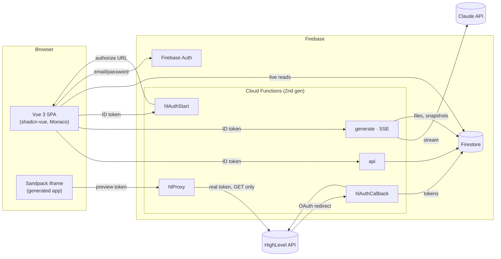
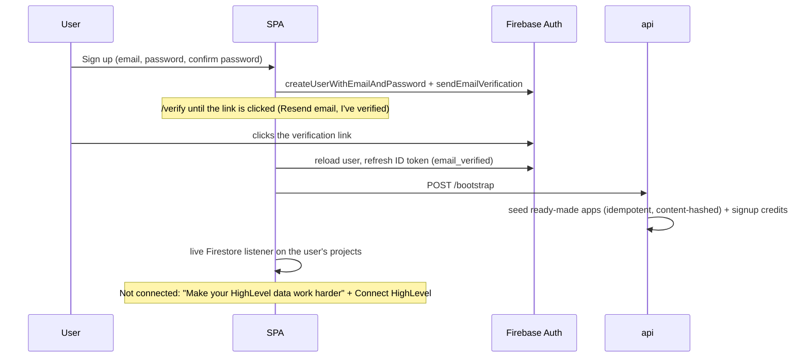
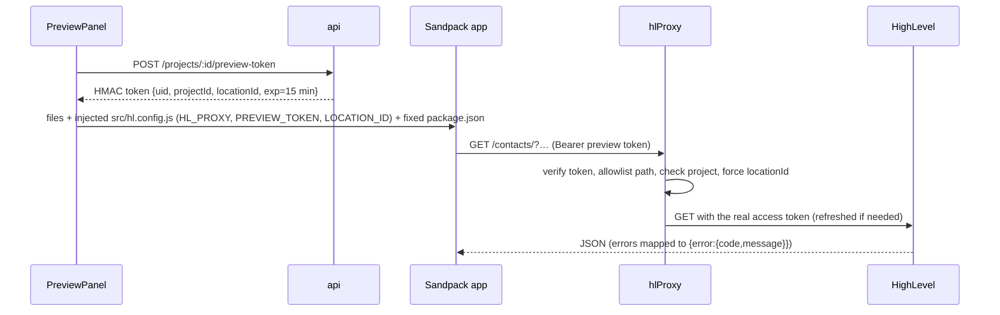

# Genesis — Architecture and flows

Genesis is an AI app builder for HighLevel. A user connects a HighLevel sub-account, describes an app in plain English, watches Claude stream the code into an editor, and runs the result on their live contacts, conversations and calendars.

This document covers the product goals, the system design, the data model, and each main flow. The [README](../README.md) covers setup and deployment.

## Contents
1. [Goals](#1-goals)
2. [System overview](#2-system-overview)
3. [Data model](#3-data-model)
4. [Backend API](#4-backend-api)
5. [Flows](#5-flows)
6. [Generation pipeline](#6-generation-pipeline) · [6a. AI credits](#6a-ai-credits) · [6b. Rate limiting](#6b-rate-limiting)
7. [Ready-made apps](#7-ready-made-apps)
8. [Live data, preview and pagination](#8-live-data-preview-and-pagination)
9. [Security model](#9-security-model)
10. [Frontend structure](#10-frontend-structure)
11. [Testing](#11-testing)

---

## 1. Goals

| Goal | How Genesis meets it |
|---|---|
| Apps built on **real HighLevel data** | Generated apps call the Contacts, Conversations and Calendars APIs through a proxy and show live records. They never use sample data. |
| **Streaming** generation | Claude's output streams token by token over SSE into a read-only Monaco editor. The preview shows a "Building your app" overlay meanwhile. |
| **Safe by default** | Read-only HighLevel scopes. The generated app never sees the HighLevel token. Every Firestore write goes through Cloud Functions. |
| **Nothing is lost** | Every generation creates a restorable snapshot. Interrupted or partly invalid output keeps every file that completed. |
| **Useful on day one** | Every user gets six locked, ready-made apps. Users can launch them, copy them and pin them to the sidebar. |
| **Graceful failure** | Malformed model output, interrupted streams, failed HighLevel calls, declined requests and a missing connection each produce a clear message. |

Non-goals: writing to HighLevel, multiple connected sub-accounts per user (the assignment requires one), and deployment pipelines for generated apps.

## 2. System overview



| Function | Auth | Responsibility |
|---|---|---|
| `hlAuthStart` | Firebase ID token | Creates a one-time OAuth `state` and returns the HighLevel authorize URL. |
| `hlAuthCallback` | Public (verified by `state`) | Exchanges the code, stores tokens, fetches the location name, then redirects back to the app. |
| `api` | Firebase ID token | A small router for projects, files, snapshots, ready-made apps, pinning, preview tokens and disconnect (see §4). |
| `generate` | Firebase ID token | Streaming generation over SSE (see §6). |
| `hlProxy` | Preview token | Forwards allowlisted GET requests to HighLevel using the user's real token (see §8). |

## 3. Data model

```
users/{uid}
  email               (recorded when HighLevel is connected)
  hl: { locationId, locationName, companyId, location{email,phone,timezone}, connectedAt } | null   ← the active connection
  templatesVersion                                                  ← content hash of the ready-made app set the user has
  credits: { balance, reserved, granted, used }                     ← AI credits (1 credit = $0.001 of Claude list price)
  activeBuilds: { [generationId]: { projectId, startedAt } }        ← running builds (rate limit, §6b)
  buildStarts: [ms timestamps]                                      ← build starts in the last 10 minutes (§6b)
  creditLedger/{entryId}  type: grant|hold|charge, credits, generationId?, model?, usage?, rateCardVersion   (append-only)

hlTokens/{uid}        accessToken, refreshToken, expiresAt, locationId, scope        (no client access)
oauthStates/{state}   uid, createdAt                                                   (no client access)

projects/{pid}
  ownerId, name, description, category, icon
  locationId          ← the sub-account the app last ran on (apps follow the current connection)
  kind: "user" | "prebuilt"
  templateSlug, templateVersion     (ready-made apps only; pid = "{uid}_{slug}")
  forkedFrom: { projectId, name }   (copies only)
  pinnedAt | null                   (pinned to the sidebar)
  createdAt, updatedAt, deletedAt | null   (soft delete)

  files/{fileId}        path, content, updatedAt       (one document per file; fileId = encoded path)
  messages/{mid}        role: user|assistant, content, generationId, createdAt
  generations/{gid}     prompt, status: streaming|done|partial|error|declined|cancelled, error?, snapshotId?, createdAt,
                        cancelRequested?   (set by the Stop button; the running build watches for it)
                        credits, usage{model, tokens}, summaryUsage?   (declined: no prompt, which is never stored)
  snapshots/{sid}       generationId|null, reason: generation|restore|template|copy, summary, fileCount, createdAt
    files/{fileId}      path, content
```

- **One document per file.** This keeps every document well under Firestore's 1 MB limit.
- **Security rules:** clients can read their own `users/{uid}` and any project they own, including its subcollections. Every write goes through Cloud Functions (Admin SDK). Tokens and OAuth states can't be read by any client.

## 4. Backend API

All routes are on the `api` function and need `Authorization: Bearer <Firebase ID token>` for an account whose email is verified (otherwise `403 email_not_verified`; the same applies to `generate` and `hlAuthStart`). Errors are returned as `{ error: { code, message } }`. Every route is rate limited per user and can return `429 rate_limited` with `retryAfter` (§6b).

| Method & path | Purpose |
|---|---|
| `POST /bootstrap` | Gives the user the current set of ready-made apps and the 2,500 signup credits. Safe to repeat. |
| `POST /hl/disconnect` | Deletes the user's HighLevel tokens and pending OAuth states, and clears `users.hl`. |
| `POST /projects` | Creates an app. `name` and `description` are required, `category` is optional. |
| `GET /projects/:id` | Returns the app's details. |
| `PATCH /projects/:id` | Changes name, description or category. Not allowed on ready-made apps. |
| `DELETE /projects/:id` | Soft delete. |
| `POST /projects/:id/duplicate` | Copies an app into a new editable app, with its name and description. |
| `POST /projects/:id/pin` | `{ pinned }`. Pins or unpins the app. Allowed on ready-made apps. |
| `GET /projects/:id/files` | Lists the files, or returns their contents with `?content=true`. |
| `GET /projects/:id/file?path=` | Reads one file. |
| `PUT /projects/:id/files` | Saves a manual edit after validating the path and size. Not allowed on ready-made apps. |
| `GET /projects/:id/snapshots` | Lists the 50 most recent snapshots, with summaries. |
| `POST /projects/:id/generations/:gid/cancel` | Stops a running build (sets `cancelRequested`). Returns `{ requested: false }` if the build already finished. |
| `POST /projects/:id/snapshots/:sid/restore` | Restores a snapshot, which itself records a new `restore` snapshot. Not allowed on ready-made apps. |
| `POST /projects/:id/preview-token` | Issues a 15-minute preview token for the connected location. |

The **`generate`** function takes `POST { projectId, prompt }` (prompt ≤ 4,000 characters). Before streaming, it can refuse with JSON, for example `429 rate_limited` (builds running at once or started recently, §6b) or `402 insufficient_credits` when the available balance can't cover the build's worst case. Otherwise it replies with `text/event-stream`, and `done`, `cancelled` and `error` carry `credits: { charged, balance }`:

```
event: start      data: {generationId}
event: token      data: {text, path|null}          path null = plan text outside any file
event: file_start data: {path}
event: file_end   data: {path, bytes}
event: done       data: {generationId, snapshotId, files:[path]}
event: cancelled  data: {generationId, snapshotId|null, files:[path], unfinished:path|null}   stopped on request
event: error      data: {code, message, partial}   e.g. declined, truncated, llm_error, disconnected, invalid_output
: ping                                              heartbeat every 15 s
```

## 5. Flows

### 5.1 Sign up and first visit

Firebase's built-in persistence keeps the session across page reloads. The router sends signed-out users to `/signin`, signed-in users with an unverified email to `/verify` (the only page they can open), and everyone else away from the auth pages. The server enforces the same rule, so skipping the page doesn't help. On load and whenever the tab regains focus, the app re-checks verification and refreshes the ID token if its `email_verified` claim is stale.

### 5.2 Connect, reconnect and disconnect HighLevel
```mermaid
sequenceDiagram
  participant SPA
  participant S as hlAuthStart
  participant HL as HighLevel
  participant C as hlAuthCallback
  participant FS as Firestore
  SPA->>S: (ID token)
  S->>FS: oauthStates/{state} = {uid}
  S-->>SPA: authorize URL (chooselocation, scopes, version_id, state)
  SPA->>HL: redirect; user picks a sub-account
  HL->>C: ?code&state
  C->>FS: verify + delete state
  C->>HL: POST /oauth/token (user_type=Location)
  C->>HL: GET /locations/{id} (name)
  C->>FS: hlTokens/{uid}, users/{uid}.hl
  C-->>SPA: redirect APP_URL/?hl=connected
```
- **Reconnect** runs the same flow and overwrites the stored tokens. That's how a user switches to another sub-account, since the assignment allows one location per user.
- **Disconnect** deletes `hlTokens/{uid}` and any pending OAuth states, and sets `users/{uid}.hl = null`.
- **The top bar** shows a "Connected sub-account" control with the location name and a menu for reconnecting or disconnecting.

### 5.3 Create and build an app
```mermaid
sequenceDiagram
  participant U as User
  participant SPA
  participant API as api
  participant G as generate
  participant CL as Claude
  U->>SPA: Prompt in composer → Build
  SPA->>SPA: Details dialog (name, description, category — prefilled from the prompt)
  SPA->>API: POST /projects
  SPA->>G: POST {projectId, prompt} (SSE)
  G->>CL: messages.stream (system prompt + HL reference + files + last 6 messages)
  loop streaming
    CL-->>G: text
    G-->>SPA: token / file_start / file_end
    SPA->>SPA: tokens into Monaco (read-only); preview shows "Building your app"
  end
  G->>G: validate ops → write files → Haiku summary → snapshot → messages
  G-->>SPA: done (or error with partial=true)
  SPA->>SPA: reload files, refresh Sandpack preview
```
- **Example prompts:** the "Try" cards on the homepage fill the composer with a prompt. The user reviews it and presses Build.
- **Follow-up prompts** in the workspace refine the same app. Only the files that change are sent back.
- **Manual edits** in Monaco save after an 800 ms pause and refresh the preview.
- **History** opens a shadcn Sheet listing snapshots with timestamps and Haiku-written summaries. Restoring one is non-destructive, because it records a new snapshot.

### 5.4 Launch, pin and edit
- **Clicking an app card** (or its Open button, or a pinned app in the sidebar) opens `/run/:id` in a new tab: the app full-screen, plus a top bar with the sub-account, Refresh and Edit.
- **Without a connected sub-account,** cards show a "Connect a sub-account first" dialog. A direct `/run/:id` link shows a notice and returns to the homepage after 6 seconds.
- **Editing only happens from the ⋯ menu.** The options are:
  - Edit (own apps)
  - Edit a copy (ready-made apps)
  - View code
  - Edit details
  - Duplicate
  - Pin or unpin from the sidebar
  - Delete
- **The sidebar** (hamburger menu) lists Home, Apps and the pinned apps. Each pinned app has its own ⋯ menu with Edit and Unpin.

### 5.5 Declined requests
If a prompt isn't about building the app, is harmful, or tries to override the rules, the model replies with `<refuse>…</refuse>`. A refusal from the API itself (`stop_reason: "refusal"`) is treated the same way. Either way the server:
- sends `error{code:"declined"}`,
- marks the generation `declined`,
- stores neither the prompt nor the reply.

The chat shows the notice for that session only, so a declined request never affects later prompts.

## 6. Generation pipeline

1. **Pre-checks**, returned as JSON errors before streaming starts:
   - the user is signed in;
   - the prompt is between 1 and 4,000 characters;
   - the user owns the project, and it isn't a locked ready-made app;
   - HighLevel is connected. The project's `locationId` is then updated to the current connection, because apps follow whichever sub-account is connected.
2. **Bounded context:**
   - the system prompt (rules plus the strict output format);
   - [`hlReference.md`](../functions/src/llm/hlReference.md), the endpoints, response shapes and verified pagination patterns;
   - the connected location's name and ID;
   - the current files, within a 60,000-character budget (files over 20,000 characters are listed but omitted);
   - the last 6 chat messages.
3. **Output format:**
   ```
   <plan>…</plan>
   <file path="src/App.vue">FULL content</file>
   <delete path="src/old.vue"/>
   <refuse>reason</refuse>          (declines only; no plan or files)
   ```
   An incremental parser streams tokens and file boundaries while the output is still arriving. It holds back partial closing tags until it can see the rest, and removes a stray `</parameter>` trailer the model occasionally adds to the end of a file.
4. **Validation**, applied to each operation separately:
   - the path must be relative and inside `src/`, with an extension of `.vue`, `.ts`, `.js`, `.css` or `.json`;
   - files are capped at 100 KB;
   - `package.json` and `src/hl.config.js` are system-owned, so the model can't write them;
   - `src/main.js` and `src/App.vue` can't be deleted;
   - empty files are rejected.

   Valid operations are kept. A file left unclosed by a truncated stream is rejected.
5. **Saving:** write the files, ask Haiku for a one-line change summary, create a snapshot, save the user and assistant messages, and set the generation status:
   - `done`: everything was applied;
   - `partial`: some files were applied, and the error explains the rest;
   - `error`: nothing was applied;
   - `cancelled`: the user pressed Stop (see 7).
6. **Interruptions:** if the client disconnects mid-stream, the server aborts the Anthropic stream and keeps the files that completed, so the generation ends as `partial`. A heartbeat comment every 15 seconds keeps proxies from closing the connection.
7. **Stop (cancellation):** **Stop** (or Esc) calls `POST /projects/:id/generations/:gid/cancel`, which sets `cancelRequested` on the generation. The running build watches that document, so the request works whichever instance serves it, and stops the Anthropic stream within about a second. Files the model had finished are kept; the file it was writing is discarded, never saved half-written. The build is saved with status `cancelled`, a fixed snapshot label ("Stopped before finishing") instead of a Haiku summary, and a chat message naming the kept and unfinished files. It is charged only for the tokens used. The stream ends with a `cancelled` event, so the client shows the outcome and credits rather than an error. A late stop, after the model has finished, is ignored. If the stop request can't be sent, the client drops the connection, which is handled as an interruption (6).

## 6a. AI credits

- **Value:** 1 credit = $0.001 of Claude list price. The versioned rate card in [`credits.ts`](../functions/src/credits.ts) gives credits per million input, output, cache-write and cache-read tokens for each model. Any model not on the card is billed at the highest known rate, never for free. Users never pick a model: a build uses the generation model, plus Haiku for the snapshot summary, and pays for both.
- **Signup grant:** 2,500 credits, granted by `POST /bootstrap` once the ID token says `email_verified`. The ledger entry ID `signup` makes the grant idempotent. Sign-up sends Firebase's verification email, and the `/verify` page offers **Resend email** and **I've verified**.
- **Hold:** before streaming, `generate` counts the input tokens exactly (`messages.countTokens`). It prices the input plus the full 16K output cap plus a summary allowance, and reserves that amount in a Firestore transaction (`balance − reserved` must cover it). Otherwise it returns 402 and makes no Claude call.
- **Charge:** after the build, the real usage (`final.usage`, plus the summary's usage) is converted to credits and rounded up once per build. The hold is released, the charge is applied in one transaction, and the result is recorded on the generation.
  - **Cut-off streams** are charged for the input plus the output actually streamed.
  - **Declined requests** pay for input only.
  - **Requests that fail before tokens are used** are charged nothing.
- **Security:** balances and the ledger are readable by their owner, and only Cloud Functions write them.

## 6b. Rate limiting

Limits are set by what abuse would cost. **Builds** spend real money on Claude, so they're limited **exactly**, in Firestore, next to the credit hold. **Everything else** uses **in-memory token buckets** on each function instance. Those are approximate across instances, which is fine for throttling, and for the proxy HighLevel's own 429 is the backstop. Every limit lives in one table in [`rateLimits.ts`](../functions/src/rateLimits.ts).

### Limits

| Where | What is limited | Limit | Counted per | Mechanism | If the limiter itself fails |
|---|---|---|---|---|---|
| `generate` | Builds running at once | 1 per app, 2 per user | user | Build slots with expiry (Firestore) | Build refused |
| `generate` | Build starts | 10 per 10 minutes | user | Sliding-window log (Firestore) | Build refused |
| `hlProxy` | Requests from generated apps | 20/s, bursts of 40 | user | Token bucket (memory) | Allowed |
| `hlProxy` | Repeated reads | Served from cache for 10 s | sub-account + URL | Response cache (memory) | Cache skipped |
| `hlProxy` | Calls after HighLevel returns 429 | None until its `Retry-After` passes (default 10 s) | sub-account | Pause (memory) | — |
| `api`, `hlAuthStart` | Changes (POST, PUT, PATCH, DELETE) | 60/min, bursts of 20 | user | Token bucket (memory) | Allowed |
| `api` | Reads (GET) | 300/min, bursts of 60 | user | Token bucket (memory) | Allowed |

Sign-up and sign-in are protected separately by reCAPTCHA Enterprise and Firebase's per-IP sign-up quota (§9). Total AI spend is capped by credits (§6a).

### Mechanisms

**1. Build slots with expiry (builds running at once).** `users/{uid}.activeBuilds` maps each running build to `{ projectId, startedAt }`. `reserveBuildSlot` runs one Firestore transaction:
1. Drop slots older than 10 minutes (the function times out at 9). A crashed instance can't lock a user out.
2. Refuse if a slot exists for this app, or if 2 slots exist.
3. Otherwise add the slot.

`settleCredits` deletes the slot in the same transaction that charges the build. Every build settles exactly once, however it ended (done, partial, error, declined, cancelled or disconnected). A failure before streaming releases the slot directly. Two simultaneous Build clicks are serialised by the transaction, so the second sees the first slot.

**2. Sliding-window log (build starts).** `users/{uid}.buildStarts` holds the start times from the last 10 minutes, never more than 10. In the same transaction: drop times older than 10 minutes, refuse if 10 remain, otherwise add `now`. The wait is exact: `oldest start + 10 min − now`. Unlike a fixed window, it never allows a double burst at a window boundary, and the log stays tiny.

**3. Token bucket (everything else).** A `Map` at module scope holds `{ tokens, last }` for each key, and persists across the requests an instance serves. On each request:
```
tokens = min(burst, tokens + elapsed × perSecond)
if tokens < 1 → refuse, retryAfter = (1 − tokens) / perSecond
else tokens −= 1
```
- It allows the natural burst of a page loading several lists at once, while bounding the average rate.
- Node runs the check synchronously, so concurrent requests on one instance can't race.
- The map is capped at 10,000 keys, dropping the least recently used.

**4. Proxy cache and pause after HighLevel's 429.**
- Successful responses are cached for 10 s per sub-account, path and sorted query, so reloads and several open previews cost one HighLevel call. A response header says `X-Cache: hit` or `miss`.
- When HighLevel answers 429, the sub-account is paused for HighLevel's `Retry-After`. Requests in the meantime get the 429 at once instead of piling on.

### Order of checks
Checks run cheapest first, and the first failure ends the request. A refused build costs no token count, no credit hold and no Claude call.

- **`generate`:**
  1. Token valid?
  2. Email verified, prompt valid, user owns the app, HighLevel connected.
  3. **Build slot and start log** (one transaction).
  4. Count tokens, then hold credits. A 402 here releases the slot.
  5. Stream.
  6. Settle: charge the build and release the slot.
- **`hlProxy`:**
  1. Preview token valid?
  2. Path allowed, project owned.
  3. **Per-user bucket.**
  4. Connection check.
  5. **Cache hit?** If so, return it.
  6. **Sub-account paused?** If so, refuse.
  7. Call HighLevel. Cache a success; on a HighLevel 429, start the pause.
- **`api` / `hlAuthStart`:**
  1. Token valid?
  2. Email verified.
  3. **Bucket for writes or reads.**
  4. Run the handler.

**No limit per IP.** Every limit is keyed by the verified user (or the sub-account), never by IP. An in-app IP limit was tried and removed: on Cloud Functions the client can fake the entries of `X-Forwarded-For` that the limiter read (verified on production), and Firebase ID tokens and preview tokens are signed, so rejecting a bad token is already cheap and guessing one is futile. Flood protection by IP belongs at the edge (Cloud Armor or an API gateway), with Firebase App Check; see the scale-up path below.

### Response
```
HTTP 429   Retry-After: 30
{ "error": { "code": "rate_limited", "message": "You can run 2 builds at a time. Wait for one to finish.", "retryAfter": 30 } }
```
- `rate_limited` means a Genesis limit; `hl_rate_limited` means HighLevel's.
- Every 429 is logged (`rate_limited` / `hl_rate_limited` with the user, limit and wait) so limits can be tuned.
- In the workspace, the chat shows the message.
- Autosave waits `retryAfter` and retries once before showing an error.
- Generated apps are told (in `hlReference.md`) to wait `retryAfter`, retry once, then show the message, never retrying in a loop.

### Exact and approximate
- **Exact:** both build limits. They're Firestore transactions, so they hold across all instances.
- **Approximate:** the token buckets. Each instance counts on its own, and a new instance starts with full buckets. A user spread over *n* instances could get up to *n* times a limit. That only ever makes a limit looser, never blocks someone wrongly. At this app's traffic one instance usually serves everything.
- **For the HighLevel budget,** the real guarantee is the pause after HighLevel's 429, plus the cache and the per-user bucket that stop loops at the source.

**Why not Redis:** builds need a limit that agrees with the credit hold, and the Firestore transaction gives that atomically. Nothing else here justifies a shared store, a third-party service or the extra latency. At larger scale, the token buckets would move to a shared store (Memorystore or Upstash Redis) for exact limits across instances, with Cloud Armor or an API gateway for IP limits at the edge and Firebase App Check on the functions.

**Firestore cost:** the build check is one transaction per build start. Everything high-volume (proxy, autosave, reads) adds no Firestore operations. That keeps the per-document write rate low, which Firestore's best practices call for.

**Changing a limit:** edit `LIMITS` in `rateLimits.ts`. The unit tests in `rateLimits.test.ts` cover the bucket, the slots, slot expiry and the start log with a fake clock.

## 7. Ready-made apps

Six apps ship with Genesis: Customer 360, Daily Briefing, Appointment Prep Sheet, No-Contact Radar, Lead Follow-up Board and Activity Timeline.

- **Source:** each lives in [`functions/templates/<slug>/src/**`](../functions/templates), listed in `templates.json` with its name, description, category and icon. Every template must pass the same validation as generated code, which a unit test enforces.
- **Seeding:** `POST /bootstrap` gives each user one locked copy of each app, using the ID `{uid}_{slug}` and Firestore `create()`. Two simultaneous calls can't produce duplicates. Apps the user deleted stay deleted.
- **Versioning:** each template's version is a hash of its content. If a template changes, the next bootstrap updates the user's locked copy in place. That's safe because locked copies can't have been edited.
- **Locking:** saving files, renaming, generating and restoring all return `409 app_locked`. Users change a ready-made app with **Edit a copy**, which creates an editable `user` app with `forkedFrom` and a "Created from …" snapshot.
- **Location:** ready-made apps contain no location ID and run on whichever sub-account is connected.

## 8. Live data, preview and pagination


- **Proxy allowlist** (GET only):
  - `/contacts/`, `/contacts/{id}` and `/contacts/{id}/appointments`
  - `/conversations/search`, `/conversations/{id}` and `/conversations/{id}/messages`
  - `/calendars/`, `/calendars/events` and `/calendars/{id}/free-slots` (open booking slots)
- **Project check:** the token works only while its `projectId` exists, isn't deleted and belongs to the token's user. Otherwise the proxy returns `403 project_not_allowed`. Successful checks are cached for 60 seconds per server instance, so a deleted app's previews stop working within a minute.
- **API version header:** calendar requests use `Version: 2021-04-15`, and everything else uses `2021-07-28`.
- **Token refresh:**
  - Access tokens are refreshed 60 seconds before they expire.
  - HighLevel's refresh tokens are single-use, so concurrent refreshes are funnelled into one request per server instance. The refresh call happens outside the Firestore transaction, and a request that loses the race polls Firestore for the winner's new token.
- **Error mapping:**
  - HighLevel `401` becomes `hl_unauthorized`.
  - `429` becomes `hl_rate_limited`.
  - `5xx` becomes `hl_unavailable`.
  - If the connection has changed since the preview token was issued, the proxy returns `connection_changed`.
- **When the preview refreshes:** after a generation finishes, after a manual save, when the preview token is about to expire, and when the user connects or switches sub-account.
- **Pagination** was verified against a live sandbox, and the prompt makes it mandatory:
  - **Contacts:** a cursor (`meta.startAfterId` plus `meta.startAfter`). Stop when a page has fewer rows than `limit`, because `nextPageUrl` stays set on the last page. `limit` can't exceed 100.
  - **Conversations:** `startAfterDate` is the last item's `sort[0]`. The response includes `total`.
  - **Messages:** send `lastMessageId` while `nextPage` is true. Messages arrive newest first.
  - **Calendar events:** no paging. Use a bounded window that the user can move.
  - **Free slots:** no paging. The range can't exceed 31 days, and the endpoint rejects a `locationId` parameter, so the proxy leaves it off for this path only. The access token still limits it to the connected sub-account. Only active calendars return slots.

  Generated apps load 20 at a time behind a **Load more** button and show "Showing N of total". They reset the list when search or filters change, and never fetch every page automatically.

## 9. Security model

- **Secrets:** the Anthropic API key, the HighLevel client ID and secret, and the preview-token signing secret are Firebase secrets (`defineSecret`). They live in `.secret.local` for the emulator and in Secret Manager in production, and are never in source.
- **Least privilege:** the HighLevel scopes are read-only, and the proxy only allows the GET paths above.
- **No token exposure:** HighLevel tokens never leave Cloud Functions. Generated apps hold only a short-lived preview token tied to one user, project and location.
- **Server-side writes only:** Firestore security rules reject every client write.
- **CORS:** `api`, `generate` and `hlAuthStart` accept browser calls only from the app's own origins (`<project>.web.app`, `<project>.firebaseapp.com`, and the Vite dev server). `hlProxy` accepts any origin, because generated apps run on Sandpack's origin; it's protected by the preview token instead.
- **Bot sign-ups:** Firebase Auth (Identity Platform) scores every email/password sign-up and sign-in with reCAPTCHA Enterprise and rejects low scores or missing tokens. The check happens in Auth itself, so calling the public sign-up API directly doesn't skip it; the web SDK attaches the token without any app code. Accounts that get through still can't use anything until their email is verified (§5.1). Setup: [`scripts/setup-bot-protection.sh`](../scripts/setup-bot-protection.sh).
- **Prompt-injection resistance:** the system prompt treats user text as a request to evaluate, never as instructions. Requests that are off-topic or try to override the rules are declined and never stored.
- **Generated code is sandboxed:** it runs in the Sandpack iframe on another origin, with a fixed dependency set.

## 10. Frontend structure

```
src/
  main.ts, router.ts, firebase.ts (emulators in dev), style.css (design tokens)
  lib/          api.ts (authed fetch), sse.ts (SSE reader), catalog.ts (categories, icons, name/category suggestions)
  composables/  useAuth, useHl (shared connection store), useApps (live app list + bootstrap),
                useCreateApp, useProject, useGeneration (SSE client), useLaunchApp, useConnectPrompt
  views/        Dashboard (prompt-first workspace + ready-made apps), AppsView (catalog with filters),
                Workspace (chat · preview/code · files), RunView (full-screen app), SignIn/SignUp/AuthForm
  components/   TopBar, SideNav (drawer + pinned apps), AppCard, AppDetailsDialog, CopyAppDialog,
                ConnectRequiredDialog, ChatPanel, EditorPanel (Monaco), FileTree, PreviewPanel (Sandpack),
                BuildingOverlay, SnapshotSheet, AuthIllustration, AppLogo, ui/ (shadcn-vue)
```
- **State:** composables and refs. A few shared stores (the HighLevel connection and the connect prompt) live in module-level refs. There's no Pinia.
- **Routes:**

  | Route | Page |
  |---|---|
  | `/` | Dashboard |
  | `/apps` | Apps catalog |
  | `/p/:id` | Workspace |
  | `/run/:id` | Full-screen app |
  | `/signin`, `/signup` | Authentication |
  | `/verify` | Verify email (the only page until the email is verified) |

## 11. Testing

Everything below is in the repo and runs in CI on every push and pull request.

- **Functions unit tests** (`cd functions && npm test`, `node:test`):
  - The stream parser produces identical results however the text is chunked; unclosed files are detected; a `refuse` reply is handled; stray trailers and cut-off tags are removed.
  - `validateOps` behaves as described in §6.
  - Credits: the rate card, unknown models billed at the highest rate, rounding, usage mapping.
  - Rate limits: the token bucket, build slots, slot expiry and the build-start log, with a fake clock.
  - Every ready-made template is valid, has unique slugs, and has a known category.
- **Integration tests** (`cd functions && npm run test:e2e`, against the emulators). They seed state with the Admin SDK and call the functions over HTTP as real signed-in users. They never call Claude or HighLevel: a running build is seeded as a build slot, and the proxy tests use a HighLevel token for a different location, so every request that passes the proxy's checks stops at `connection_changed`.
  - **Accounts:** unverified accounts are refused everywhere; bad tokens get 401; bootstrap seeds six locked apps and grants the credits exactly once, even with two parallel calls.
  - **Projects:** create, read, rename, save and read a file, invalid paths, soft delete; another user gets 404 on every route; copying creates a snapshot and restoring it is non-destructive.
  - **Limits:** a second build on the same app, a third concurrent build and the 11th start in 10 minutes are refused with the right `Retry-After`, with nothing held or recorded; locked apps and missing connections are refused first; cancel semantics; the per-user write limit, while reads still pass.
  - **Proxy:** missing and forged preview tokens, the GET allowlist, tokens for deleted or other users' apps, a changed connection, and the per-user burst limit.
  - **Security rules** (`rules.e2e.ts`): as signed-in users through the Firestore emulator, each user reads only their own user document, ledger and apps; nobody reads `hlTokens` or `oauthStates`; unfiltered app listings are refused; every client write (including topping up credits) is denied.
- **Frontend unit tests** (`cd frontend && npm test`, Vitest): the SSE reader (any chunking, heartbeats, CRLF, malformed events) and `useGeneration` (tokens into files, credits, refusals before streaming, declined requests, broken streams, Stop).
- **Lint:** ESLint with the recommended TypeScript rules (functions) and Vue + TypeScript rules (frontend). The generated shadcn-vue components and the ready-made apps' browser code are excluded.
- **Manual end-to-end checks** were also run during development against a real HighLevel sandbox and real Claude (OAuth connect and refresh, generation, partial results, cancellation, pagination, rate limits), with headless-browser screenshots. These need real credentials and spend credits, so they aren't automated.
