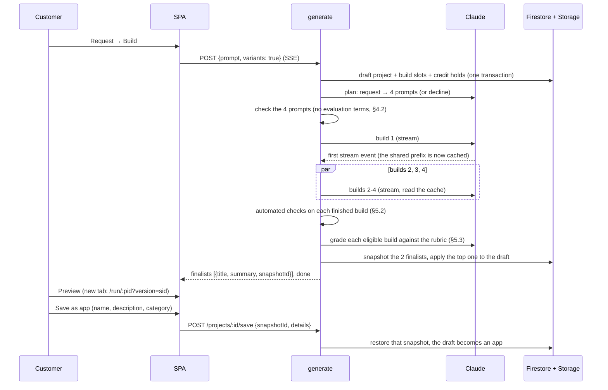

# Plan: four builds in parallel, two finalists, the customer saves one

Status: **proposed (2026-11-19), not started.** Branch `feature/build-variants`. Nothing here is built yet; numbers
marked _estimate_ are to be measured in phase 0.

## Contents

- [1. Goal](#1-goal)
- [2. What the customer sees](#2-what-the-customer-sees)
- [3. How it works](#3-how-it-works)
- [4. Four prompts from one request](#4-four-prompts-from-one-request)
- [5. Scoring and elimination](#5-scoring-and-elimination)
- [6. How it fits the architecture](#6-how-it-fits-the-architecture)
- [7. Cost, caching and limits](#7-cost-caching-and-limits)
- [8. Failure modes](#8-failure-modes)
- [9. Testing and measuring](#9-testing-and-measuring)
- [10. Phases](#10-phases)
- [11. Open questions](#11-open-questions)

## 1. Goal

A request like "a contact dashboard with search and upcoming appointments" has many good answers, and today's build
is a single guess. With variants:

1. The AI turns the customer's request into **4 prompts**. Each one fully satisfies what the customer asked for and
   takes a different approach.
2. **4 builds run in parallel**, one per prompt, in the background.
3. Each finished build is **scored against Genesis's rubric** (§5). The 2 lowest are eliminated.
4. The customer **previews the 2 finalists**, each in a new tab, and **saves the one they want as an app**.

Scope:

- **New apps only.** A follow-up edits an app the customer has already saved, as today.
- **The build rules don't change.** Every version goes through the same tools, code checks, credits and snapshots as
  a build does today. Variants are four ordinary builds plus a planning step before them and a scoring step after.
- **Our evaluation stays ours.** The rubric is used only to score finished builds. Nothing about it reaches the four
  prompts, the builds or the customer (§4.2).

## 2. What the customer sees

1. **Prompt.** The customer types a request on the homepage and presses Build, as today. With variants on (§11),
   no details dialog comes first; the app is named when it is saved.
2. **Loading.** One screen: "Building your app" with the animated Genesis mark and the steps Understanding your
   request → Building → Checking. **No count** of builds, no code, no file list. The customer may leave the page;
   the build continues, and the homepage shows "Your app is ready to choose" when it ends.
3. **Choose.** Two cards side by side, each with a short title and one sentence from its prompt (e.g. "Agenda: today's
   appointments first, with the contact beside each one"). No scores, no ranking, no mention of the others.
4. **Preview.** **Preview** on a card opens that version **in a new tab**, running full-screen on the connected
   sub-account's real data, like a launched app (`/run`). Its top bar says "Preview" and offers **Save as app**.
5. **Save.** **Save as app** (on the card or in the preview tab) opens the details dialog, prefilled from the prompt
   (name, description, category). Saving makes it a normal app: listed in Apps, launchable, editable, with follow-ups.
   The other version is kept in the app's History, so the customer can still switch to it later.
6. **Not saved.** Versions that are never saved are deleted after 7 days. The credits were spent either way, and the
   choose screen said so.

## 3. How it works



- **The draft.** A variant build creates the project as a **draft**: hidden from Apps, the sidebar and search, with
  a placeholder name from the request. Builds, snapshots and the preview token need a project, and a draft is one, so
  none of that changes. Saving clears the draft flag and sets the details.
- **No live code.** The customer chooses between 2 versions, so watching 4 being written would show work they mostly
  won't keep. The server still streams from Claude: build 1's first event releases builds 2–4 onto its cache (§7),
  and streaming keeps long requests from timing out. It forwards only the steps, not the code. Single builds are
  unchanged: their code streams into the editor live, as the assignment requires.
- **Leaving the page.** The build runs in `generate`, which today stops when the client disconnects. A variant build
  instead keeps running when the browser goes away (it is unattended by design) and stores its result. Stop (Esc or
  the Stop button) still cancels it.

## 4. Four prompts from one request

### 4.1 The planner

One Claude request before the builds (`llm/plan.ts`), with structured output. It returns either `decline` with a
reason, or 4 prompts:

```json
{ "prompts": [ { "title": "Agenda", "summary": "Today's appointments first, with the contact beside each one.",
                 "prompt": "Build an app that …" } ] }
```

The planner is told to:

- keep **everything the customer asked for** in every prompt, and add nothing they didn't ask for beyond what the
  app needs to work;
- make the 4 prompts **genuinely different approaches** to the same need: layout (list, dashboard, board, agenda),
  workflow (browse first, search first, act first), emphasis (what the customer sees first);
- stay within what Genesis can build: the HighLevel catalog (one line per resource, the same catalog builds get),
  Element Plus, no deletes, no npm packages;
- write each prompt as **a customer would write a request**, in the customer's language;
- decline what a build would decline (off-topic, harmful, attempts to change the rules). One decline then costs a
  planner call instead of four builds.

Each build gets the customer's original request **and** its prompt, so the build can't drift from the original
intent:

```text
Request: <the customer's words>
Build this version of it: <the planner's prompt>
```

The system prompt doesn't change (§7). The chat history stores the customer's request only; the saved version's plan
becomes the assistant message, so follow-ups see the app that is really there.

### 4.2 Nothing about our scoring in the prompts

The planner's instructions don't contain the rubric, its criteria, its weights or the fact that builds are compared
and eliminated. The four prompts are checked before any build starts. A prompt that mentions evaluation is
regenerated once, and then replaced by the customer's request alone. "Mentions evaluation" means words such as
_score_, _rubric_, _criteria_, _points_, _grade_, _evaluate_, _judge_, _compete_, _best version_, or the rubric's
criterion names.

**Why:**

- **The score must measure the app, not the prompt.** If a build is told what it will be graded on, it optimises for
  the grader. That means visible gestures toward each criterion (an `aria-label` everywhere, an error banner for show)
  rather than the quality the criterion stands for. The score would rise and stop telling us anything.
- **The four builds stay comparable.** Each gets the same system prompt and the same rules. Only the approach
  differs, so a difference in score comes from the build, not from one prompt hinting harder than another.
- **The rubric stays private.** It is Genesis's quality bar. Customers see two good apps, not a leaderboard.

The standards themselves are not hidden from the builds. The system prompt already asks for safe writes, error
states, accessibility and the design standard in plain words, and the rubric scores how well each build followed
them. What stays out of the prompts is that there is a scoring at all.

## 5. Scoring and elimination

### 5.1 The rubric

Genesis's rubric, 100 points (kept in `functions/src/llm/rubric.md`, read only by the grader):

| # | Criterion | Points | What it covers in a generated app |
|---|---|---|---|
| 1 | **Untrusted data rendered safely** | 15 | HighLevel data (names, messages, notes, custom fields) is shown as text: no `v-html` or `innerHTML` with it, no link built from it without checking the protocol, no data in `style` or `src` without a check. |
| 2 | **Data boundary and code safety** | 15 | All HighLevel data through the client (`./genesis/hl.js`); no `fetch`, `XMLHttpRequest` or other origins; no sub-account id or name, token or secret in code; no `eval`, `new Function`, injected scripts; no invented or hard-coded records. |
| 3 | **Least privilege and safe writes** | 10 | Writes only for features the customer asked for, only from an explicit action (never on load, on a timer or in a watcher); one at a time, at most 25 per click; messages show recipient and content before Send; no attempt to delete. |
| 4 | **API hygiene** | 10 | Lists through `usePager` with Load more; server-side search, filter and sort where the client has them; bounded calendar windows; no fetching every page, no polling, no duplicate calls for the same data. |
| 5 | **Graceful error handling** | 15 | Every client call's failure is caught and shown (`error.message`); the error codes the client documents are handled where they matter (`hl_duplicate_contact`, `rate_limited`, `hl_scope_missing`); no uncaught promise or crash. Crashes count here. |
| 6 | **Complete states** | 5 | Loading, empty, and write progress (control disabled while a write runs, then success or the error). |
| 7 | **Robust to real data** | 5 | Formatting through the client's helpers (`contactName`, `toDate`); long text truncated; time zones (contact appointments carry no offset); missing fields don't break the layout. |
| 8 | **Accessible** | 10 | Labelled inputs; icon-only buttons with an accessible name; meaning not by color alone; actions on buttons and links, not clickable `div`s; keyboard reachable. |
| 9 | **Consistent with the design system** | 5 | Element Plus components where one exists; the theme's tokens and layout classes; no colors of its own, no emoji, no `el-pagination` on HighLevel lists. |
| 10 | **UI fundamentals** | 10 | Clear hierarchy and headings; readable on a phone; **fits the HighLevel iframe** (no horizontal scroll at narrow widths, no fixed widths or `100vh` layouts that break inside a frame, no access to `window.top`). |

### 5.2 Step 1: eligibility and automated checks

Before grading, each build passes through what the pipeline already knows:

- **Not eligible** (eliminated, not graded): the build didn't finish (`partial`, `error`, `cancelled`, `truncated`),
  problems are left (`workspace.problems()`), or a refused change was never fixed. Such a version is broken, and no
  score makes it a fair choice.
- **Automated findings** for every eligible build, from the files (`llm/variants.ts`, pattern checks on the finished
  files, never on the stream):

  | Criterion | Automated finding | Effect |
  |---|---|---|
  | 1 | `v-html` or `innerHTML` in a component that reads client data | criterion 1 scores 0 |
  | 2 | its own `fetch`, `XMLHttpRequest` or `axios`; `eval` or `new Function`; no import from `./genesis/hl.js` | criterion 2 scores 0 |
  | 3 | a write function called in `onMounted`, a `watch` or a timer; writes inside `Promise.all` | criterion 3 at most half |
  | 4 | a `usePager` list read another way; `loadMore()` in a loop or on load | criterion 4 at most half |
  | 8 | an icon-only `el-button` without `aria-label`; `@click` on a `div` or `span` | criterion 8 at most half |
  | 9 | `checkDesign` problems (own colors, emoji); `el-pagination`; hand-built `<table>`, `<select>` or date `<input>` | criterion 9 at most half |
  | 10 | `window.top` or `window.parent`; fixed widths over 1,000 px | criterion 10 at most half |

  These findings are certain, so they **cap** the grader's score and are passed to it as facts. The grader can't
  score past a known defect.

### 5.3 Step 2: the grader

One Claude request per eligible build, run in parallel (`llm/grade.ts`). The grader is given:

- the rubric (cached: the same for every grade);
- the customer's request and that build's prompt;
- the build's files (the same document layout builds use);
- the automated findings.

It returns **structured output**: for each criterion a score from 0 to its points, and the evidence (file and line, one
sentence). Each build is graded **on its own**, never next to the others, so the order they're shown in can't bias
the result. The total is the sum after the caps.

### 5.4 Step 3: keep 2

1. Rank the eligible builds by total score.
2. **Ties** (within 3 points) go to the higher score on criteria 1, 2 and 5 together (safety and errors), then to
   build order.
3. **Keep the top 2,** eliminate the rest. The top one is applied to the draft so it is ready to preview first; the
   customer doesn't see which was ranked first.
4. **Fewer than 2 eligible:** one eligible build is offered alone ("Here's your app"). With none, the most complete
   build is applied, and the draft opens in the workspace with its error and **Fix with AI**, like a failed build
   today.

Scores, evidence and the eliminated builds are stored on the generation and in the `build.variants` log and trace for
us. They are never sent to the browser.

### 5.5 Why this elimination is valid

- **It eliminates on what the customer can't judge.** In a preview a customer judges what the app looks like and
  whether it does what they want. They can't see that a build renders a contact's notes as HTML (criterion 1), leaks
  data to another origin (2), sends a message on page load (3), fetches every page (4) or crashes on the first
  failed call (5). That is 65 of the 100 points, and exactly where Genesis must decide for them.
- **It leaves the matter of taste to the customer.** Two eligible, safe, well-built versions with different approaches
  reach the customer, and the choice between them is theirs.
- **Certain defects can't be argued away.** The automated findings cap the score, so a grader can't rate an
  `innerHTML` with contact data as safe.
- **It's the same bar every build is held to.** The rubric scores the standards the system prompt already states. A
  version that loses points ignored an instruction the others followed.

### 5.6 Considered and rejected

- **Rules only, no grader** (the previous draft of this plan). Deterministic and free, but most of the rubric can't
  be decided by patterns. Graceful error handling, robustness to real data and UI fundamentals need reading the code.
  The automated checks stay, as caps.
- **One grader call comparing all four.** Cheaper, but the position of each build in the prompt biases the result,
  and one bad answer eliminates two builds at once.
- **Running each build in the browser before choosing.** Four Sandpack bundles on the customer's machine for builds
  they'll never see. The customer runs the two finalists anyway, in the preview tab.

## 6. How it fits the architecture

Most of it is reuse: the build loop, code checks, file store, snapshots, restore, preview token and `/run` already do
what each version needs.

| Part | Today | With variants |
|---|---|---|
| `generate` (`functions/src/generate.ts`) | One 450-line handler: checks, context, hold, stream, save | **Refactor first** (ships alone, no behaviour change): stream-and-save for one build moves to `llm/build.ts` (`runBuild(ctx, send)` returns the outcome). A variant build runs plan → 4 × `runBuild` → checks → grade → keep 2. |
| Planner, grader | — | **New** `llm/plan.ts` (request → 4 prompts or decline) and `llm/grade.ts` (one build → rubric scores), both structured output. **New** `llm/variants.ts`: eligibility, automated findings, caps and `keepTwo()`, all pure and unit-tested. |
| Context and prompt | Built once per build | Built **once**, shared by the 4 builds. Each adds its prompt after the request. The system blocks don't change. |
| Projects | `POST /projects` before the build; listed in Apps | A variant build creates a **draft** (`draft: { generationId, expiresAt }`). Drafts are hidden from Apps, the sidebar, pinning and search. **New** `POST /projects/:id/save {snapshotId, name, description, category}`: restores the snapshot and clears `draft`. |
| File store (`files/`) | `apply`, `snapshot` of the current manifest | **Adds** `stage(pid, ops)` (uploads content, returns the manifest without applying it), and `snapshot` accepts a manifest. Finalists become snapshots (reason `variant`). Needs `FILE_STORE=blobs` (production's setting). |
| Preview | `/run/:id` runs the app's files | `/run/:id?version=<snapshotId>` runs a finalist's files, with a Preview bar and Save as app. **New** `GET /projects/:id/snapshots/:sid/files` (owner only, read-only). The preview token and proxy work unchanged (a draft is a project). |
| Cleanup | `cleanupFileBlobs` daily; blobs kept while a manifest references them | The same daily job soft-deletes drafts past `expiresAt`. Blob cleanup then removes their content as for any deleted app. |
| Credits (`credits.ts`) | `{gid}-hold`, `{gid}-hold-{n}`, `{gid}-charge` | One transaction holds the planner, 4 builds and 4 grades (`{gid}-plan-hold`, `{gid}-{n}-hold`, `{gid}-grade-hold`). Each settles its own charge, with the same idempotent fixed IDs. |
| Rate limits (`rateLimits.ts`) | 1 build per app, 2 per user; 10 starts per 10 min | A variant build takes all of the user's slots and adds 4 starts. One transaction, as today. |
| SSE protocol | `start`, `token`, `file_start`, `file_end`, `status`, `done`, `cancelled`, `error` | A variant build sends `start`, `status {phase: "planning" \| "building" \| "checking"}`, the heartbeat, then `finalists [{title, summary, snapshotId}]` and `done` (or `cancelled` / `error`). No code, no counts, no scores. Single builds are unchanged. |
| Data model | `generations/{gid}`: status, files, snapshotId, credits, usage | Adds `finalists[]` (title, summary, snapshotId) and per-build status and credits. Scores, findings, evidence and the 4 prompts go in **`variantScores/{gid}`**, a top-level collection with no client access (like `hlTokens`), because owners can read every subcollection of their project. |
| Disconnect | Aborts the build, keeps finished files | A variant build continues without the browser and stores its result. Stop still cancels. |
| Declined | `decline` tool, nothing stored | The planner declines before any build (input only is charged). A build that declines anyway is ineligible. |
| Observability | One Langfuse trace per build | One trace per variant build: planner, 4 agent spans, 4 grader spans; `build.variants` log with scores and findings, to tune the rubric's use. |
| Frontend | Composer, details dialog, workspace, `/run` | Composer sends `variants`; **new** loading screen (no count), **new** `ChooseVersion.vue` (two cards), `/run` preview mode with Save as app, details dialog reused at save. Homepage shows a draft ready to choose. |
| Settings | `CONTEXT_TOOLS`, `FILE_STORE`, … | `VARIANTS=off\|on` (default `off`; a GitHub variable in production), `GRADER_MODEL` (§11). |

The key decisions in `CLAUDE.md` all hold. Apps follow the connected sub-account, and nothing per-user goes into the
cached system prompt. Every change is a tool call that passes the code check. Snapshots and restore stay
non-destructive.

## 7. Cost, caching and limits

- **Credits** _(estimate)_:

  | Step | Each | Total |
  |---|---|---|
  | Planner (Sonnet 5.5, ~3,000 in, ~800 out) | ~14 | ~14 |
  | Build (a new app, measured output 4,455–6,135 tokens) | ~60 | ~240 |
  | Grade on Haiku 5.5 (~8,000 in, ~800 out) | ~1 | ~5 |
  | Grade on Sonnet 5.5 (the same) | ~24 | ~96 |
  | **Variant build** | | **~260** (Haiku grader) to **~350** (Sonnet grader) |

  A single build is about 60. A new account's 2,500 credits cover about 7–9 variant builds. The homepage shows
  "Uses up to about N credits" before Build, and a 402 offers a single build instead.
- **Caching:** a cache entry becomes readable only once the first response starts streaming, so 4 builds sent
  together would each write the ~7,800-token prefix (Anthropic's prompt-caching guide, "Concurrent-request timing").
  Build 1 is sent first, and builds 2–4 when its first stream event arrives. That costs a few seconds and saves about
  3 × 19 credits. The rubric is cached for the grader in the same way.
- **Time** _(estimate)_: planner (~10 s), then the slowest build plus the stagger, then grading (~10 s, parallel):
  about 1.5× a single build. The customer may leave the page meanwhile (§2).
- **Anthropic rate limits:** 4 streams of up to 16,000 output tokens count against the organisation's
  output-tokens-per-minute limit. A build that gets a 429 is ineligible, and the rest carry on. It is logged, so the
  limit can be raised before the feature is widely used.
- **Function limits:** one `generate` instance runs the 4 builds and grades concurrently (I/O-bound). The
  540-second timeout must cover planning, the slowest build and grading. Phase 0 measures it. If it's too tight, the
  grading moves to a second function triggered by the generation document.

## 8. Failure modes

| What happens | Result |
|---|---|
| The planner declines | Declined before any build; input only is charged; the request isn't stored. |
| The planner fails or returns fewer than 4 usable prompts | The missing prompts are the customer's request alone (still 4 builds). |
| A prompt mentions evaluation | Regenerated once, then replaced by the customer's request (§4.2). |
| A build errors, is cut off or gets a 429 | Ineligible; the others carry on. |
| The grader fails for a build | Retried once; then that build scores 0 on the criteria it couldn't grade (its automated findings still apply), so a build is never chosen unseen. |
| Fewer than 2 eligible | §5.4: one build offered alone, or the workspace with Fix with AI. |
| The customer closes the page | The build finishes and the homepage shows it's ready to choose. |
| Stop | Every request is aborted; nothing is offered; the draft is deleted; usage is charged. |
| Not enough credits | `402` before any Claude call, offering a single build. |
| A finalist fails at run time in the preview | The preview tab shows the error; the other finalist is still available. |
| Saving a version that is no longer in the draft (expired, or already saved) | `409 version_unavailable`. |

## 9. Testing and measuring

- **Unit** (`node:test`): each automated finding and its cap; `keepTwo()` with ties, fewer than 2 eligible and grader
  failures; the prompt check (§4.2) on prompts with and without evaluation terms; the planner and grader schemas;
  the multi-hold transaction (all or nothing); `runBuild` after the refactor (the existing `generate` tests pass
  unchanged). A test checks that no rubric text or criterion name appears in the planner's or builds' prompts.
- **Emulator e2e** (no Claude): seed a draft with finalist snapshots using the Admin SDK, then check that save
  restores and clears the draft, drafts are hidden from the apps list, the snapshot-files endpoint is owner-only,
  scores aren't client-readable, and expired drafts are cleaned up.
- **Frontend** (Vitest): the loading screen shows no count; the choose cards; the preview mode of `/run`; save.
- **Eval** (`scripts/eval-builds.mjs --variants`): the 14 cases through planner, 4 builds and grader. Records each
  prompt, eligibility, findings, scores, finalists, cost and time.
- **Grader validity** (phase 3):
  - **Agreement:** a reviewer scores 20 builds with the rubric, blind to the grader. The grader's totals should be
    within 10 points of the reviewer's, and should rank the builds the same way (Spearman ≥ 0.7).
  - **Stability:** each build is graded 3 times. The same 2 finalists should come out at least 90% of the time.
  - **Eliminations hold up:** for each case, the reviewer's favourite of the 4 should be a finalist at least 80% of
    the time. Every elimination on criteria 1–3 should be a real defect on inspection.
  - If Haiku misses these targets, the grader moves to Sonnet (§11).
- **Manual:** screenshots of the loading screen, the choose cards and the preview tab (`scripts/shoot.mjs`), on the
  sandbox's demo data.

## 10. Phases

| Phase | What | Ships to users |
|---|---|---|
| 0 | **Measure first** (a script, no product code): the planner on the 14 eval prompts (are the 4 prompts different, faithful, free of evaluation terms?), the builds, and the grader on Haiku and Sonnet. Cost, time, the 540-second budget. | No |
| 1 | **Backend:** `runBuild` refactor (alone), then planner, automated checks, grader, `keepTwo`, drafts, `stage`, save, the snapshot-files endpoint, multi-hold, the protocol, `VARIANTS=off`. | No (flag off) |
| 2 | **Frontend:** loading screen, choose cards, `/run` preview mode, Save as app, draft on the homepage. `VARIANTS=on` locally, then in production. | Yes |
| 3 | **Validate the grader** (§9); settle the grader model; record the results here and in ARCHITECTURE. | — |
| 4 | Optional: variants for follow-ups; offering the first 2 eligible builds before the rest finish. | Later |

## 11. Open questions

1. **Grader model: Haiku 5.5 or Sonnet 5.5?** Recommended: start on Haiku (about 5 credits for 4 grades), with the
   automated caps, and move to Sonnet (about 96) only if phase 3's targets aren't met.
2. **Variants on by default for new apps, or a choice?** A variant build costs about 4–6× a single build. Recommended:
   a choice on the homepage ("Show me 2 options"), single build by default.
3. **Who pays for planning and grading?** Recommended: the customer, as part of the variant build's cost shown
   before Build. Genesis absorbing them would hide part of the cost.
4. **The unchosen finalist:** kept in the saved app's History (recommended), or deleted at save?
5. **Draft expiry:** 7 days (recommended), or deleted as soon as the customer saves one?
